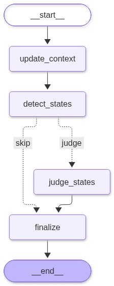

# ScamShield

한국어 통화의 보이스피싱 여부를 판단하고 탐지 시 분석과 대응 안내를 제공하는 졸업프로젝트다. 목적과 합의된 MVP 범위는 [프로젝트 컨텍스트](docs/project-context.md)에 있다.

현재 구조는 **Jev 상태 감지 + 상태별 Claude Haiku 판단**이다. 새 줄이 들어오면 Jev가 사기 수법 행동 F1~F6이 새 줄에 나타났는지 감지하고, 켜진 상태마다 Haiku가 전체 대화로 그 행동이 수상한지 판단한다. 판단으로 통화 상태(위험·주의·정상)와 점수를 만든다. [State·Graph 계약](docs/design/state-and-graph.md)과 [실행 근거](openspec/changes/jev-state-agents/work.md)를 따른다.



## 작업 시작

[AGENTS.md](AGENTS.md) → [docs/index.md](docs/index.md) → [공통 작업 흐름](docs/harness/workflow.md) 순서로 시작한다. 필요한 주제 문서와 진행 중인 작업은 각 인덱스에서 찾는다.

변경별 요구·설계·작업 진행·검증은 [OpenSpec 인덱스](openspec/index.md)에서 관련 change를 찾아 확인한다.

Codex와 Claude Code는 같은 AGENTS·문서·스킬 원본을 사용한다.

| 도구 | 작업 안내 | 스킬 진입점 | 직접 호출 |
|---|---|---|---|
| Codex | [AGENTS.md](AGENTS.md) | `.agents/skills/` | `$scamshield-work-cycle`, `$scamshield-docs-sync`, `$scamshield-github-templates`, `$scamshield-create-issue` |
| Claude Code | [CLAUDE.md](CLAUDE.md)에서 AGENTS를 import | `.claude/skills/`의 원본 폴더 링크 | `/scamshield-work-cycle`, `/scamshield-docs-sync`, `/scamshield-github-templates`, `/scamshield-create-issue` |

Claude Code의 작업 안내는 `CLAUDE.md`의 `@AGENTS.md` import로 연결하고, 스킬 내용·스크립트의 단일 출처는 `.agents/skills/`에 두며 `.claude/skills/`에는 원본을 읽어 적용하는 Claude Code 래퍼 스킬을 둔다. 사용 방식의 근거는 [공식 import 안내](https://code.claude.com/docs/en/memory#share-one-file-with-other-coding-tools)와 [공식 스킬 안내](https://code.claude.com/docs/en/skills#where-skills-live)에 있다. Claude Code 세션에서 `/context`로 작업 안내의 로드를 확인하고 `/` 메뉴에서 스킬을 확인할 수 있다. 스킬이 목록에 나타나지 않으면 AGENTS 또는 CLAUDE의 링크로 원본 지침을 직접 읽고 적용한다.

## Python 개발 환경

Python 3.12와 uv를 사용한다. 의존성은 pyproject.toml과 uv.lock으로 관리하고 .python-version은 기본 Python 버전을 지정한다.

```sh
uv sync --locked
uv lock --check --offline
```

.venv, IDE 개인 설정(.idea), 실행 캐시와 .env는 Git에서 제외한다.

## CLI 실행

API 없이 연결 흐름을 확인한다. Jev·Haiku 모두 명시적인 대역이며 실제 모델 검증이 아니다.

```sh
uv run --locked python -m scamshield --offline --auto
```

실제 모델을 사용하려면 [.env.example](.env.example)의 이름에 맞춰 로컬 `.env`에 키를 등록한다. Anthropic 키를 `ANTHROPIC_API_KEY=` 뒤에, [TypeSafe 콘솔](https://console.typesafe.ai/keys)에서 발급한 키를 `TYPESAFE_API_KEY=` 뒤에 입력한다. 키 자체만 넣으며 `Bearer `는 붙이지 않는다. `.env`는 Git에서 제외되고 자동으로 읽지 않는다.

```dotenv
ANTHROPIC_API_KEY=
TYPESAFE_API_KEY=
TYPESAFE_BASE_URL=https://api.typesafe.ai
TYPESAFE_DEFAULT_MODEL=jev-latest
```

Jev 설정 이름과 기본값은 [TypeSafe 공식 기준](https://docs.typesafe.ai/sdk/python/api/constants)에 맞췄다. 실제 연결은 표준 HTTP를 사용한다. Haiku는 `anthropic` SDK로 `claude-haiku-5-5`를 부른다. 두 키는 시작할 때 모두 확인하며 하나라도 비면 `config` 오류로 멈춘다. 키·인증 헤더·API 오류 본문을 출력하거나 커밋하지 않는다.

```sh
uv run --locked --env-file .env python -m scamshield --auto
uv run --locked --env-file .env python -m scamshield --text "안전계좌로 지금 송금하세요."
```

`--auto` 없이 실행하면 세 번 입력받으며 Enter는 준비된 문장을 사용한다. 화자 표시가 없는 입력은 `[상대]` 말로 본다. `--text`는 STT 결과에 해당하는 텍스트 한 건을 입력한다. CLI는 대화와 agent 상태를 직접 들고 요청을 이어 보낸다. Graph 입력 인터페이스는 다음과 같다.

```python
import time

from scamshield.graph import build_pipeline
from scamshield.state import NewLine

pipeline = build_pipeline()  # offline=True면 키 없는 대역
outcome = pipeline.analyze([], [NewLine(seq=1, text="[상대] 완성된 STT 텍스트")], None, time.time())
next_state = outcome.state  # 다음 요청의 state로 넘긴다
```

결과 `AnalysisOutcome`은 `status`(위험·주의·정상), `score`(0~100), `message`, `reason`, `evidence_seqs`, 이번 Jev 결과 `states`, 이번 Haiku 판단 `state_analyses`, 다음 요청에 넘길 `state`다. `analyze`는 상태를 저장하지 않으므로 호출하는 쪽이 `history`와 `state`를 들고 있어야 한다. 실제 모델의 출력은 고정 시나리오가 아니다.

캐시 권한 문제가 있으면 `uv --cache-dir .venv/uv-cache run ...`으로 실행한다. Windows에서 uv가 PATH에 없고 로컬 가상환경에 설치되어 있다면 `.venv\Scripts\python.exe -m uv`를 사용할 수 있다. 한글 출력은 `python -X utf8 -m scamshield ...`로 실행할 수 있다.

## 현재 범위

2AS의 Gemini 경로와 `voice_phishing` 질문을 뺐다. Jev 상태 6개 감지, F3·F5 보류와 재호출 규칙, 상태별 Haiku 동시 호출, 절대선·tool 보정, 점수 감소를 구현했다. tool은 고정 목록 Mock이다. Jev 실패와 Haiku 인증 실패는 오류이고, 그 밖의 Haiku 실패는 그 상태만 건너뛴다. 자동 재시도·offline 대체는 없다.

통화 상태 저장과 화자·상대 구분은 BE `agent-bridge`가 맡는다. CLI의 세 입력 제한은 데모 설정이다. 실제 tool API와 KorCCVi 평가는 후속 범위다.

## 코드 검증과 그래프 출력

```sh
uv run --locked pytest -q
uv run --locked python -m scamshield.export_graph
```

테스트는 API 없이 라우팅·보류·재호출, 절대선·tool 보정, 점수 감소, Haiku 실패 처리, BE 필드, `state` JSON 왕복, Jev·Haiku 요청 변환, CLI를 확인한다. 실제 연결과 테스트 결과는 [work](openspec/changes/jev-state-agents/work.md)에 구분한다. 탐지 성능이나 확률 보정을 검증한 것은 아니다.

그래프 출력은 실제 컴파일된 LangGraph에서 [Mermaid 원본](docs/architecture/scamshield-langgraph.mmd)과 PNG를 생성한다. PNG 렌더링에는 Mermaid.ink 네트워크 접근이 필요하며 그래프 구조만 전송하고 모델은 호출하지 않는다.

## 문서 검사

Python 3.9 이상에서 추가 패키지 없이 실행한다.

```sh
python3 .agents/skills/scamshield-docs-sync/scripts/check_docs.py
```

검사 대상은 docs·openspec·안내 문서·스킬의 로컬 링크, 문서 인덱스 누락, 하위 인덱스의 상위 연결과 change의 다섯 필수 파일이다. CLAUDE.md가 있으면 그 안의 Markdown 링크도 검사한다. 외부 URL, 제목 앵커, Claude의 import 처리·스킬 자동 인식, 문서 내용과 코드의 의미상 일치는 자동 검사하지 않는다. 내용 정합성은 [문서 동기화 스킬](.agents/skills/scamshield-docs-sync/SKILL.md)로 확인한다.

## 이슈·PR 작성

[버그 폼](.github/ISSUE_TEMPLATE/bug_report.yml)·[변경 제안 폼](.github/ISSUE_TEMPLATE/change_proposal.yml)과 [PR 양식](.github/PULL_REQUEST_TEMPLATE.md)을 사용한다. [협업 스킬](.agents/skills/scamshield-github-templates/SKILL.md)은 템플릿 유지와 PR 초안 작성을, [이슈 생성 스킬](.agents/skills/scamshield-create-issue/SKILL.md)은 작업 메모의 이슈 작성·요청받은 GitHub 등록을 지원한다.

기능 이슈는 `문제와 목표 → 변경 범위와 제약 → 완료 조건 → 관련 스펙과 작업 기록`의 같은 네 구역으로 작성한다. 예: `$scamshield-create-issue로 Verify Agent 이슈 초안 작성해줘`. 실제 등록을 원하면 `이슈 등록해줘`라고 요청한다. [Verify Agent 예시](.agents/skills/scamshield-create-issue/references/verify-agent.md)에 검사·사건번호·전화번호 조회와 시스템 프롬프트 작업을 정리했다.

이슈·PR 제목은 `type: 변경 내용` 형식을 사용한다. 기능은 `feat:`, 버그 수정은 `fix:`, 문서는 `docs:`, 환경/관리 작업은 `chore:`, 동작을 유지한 구조 변경은 `refactor:`로 쓴다. Issue Forms의 기본 제목은 기능 `feat:`, 버그 `fix:`이며 내용에 맞게 바꿀 수 있다. 데모처럼 구현 범위를 설명하는 내용은 본문에 적는다.
