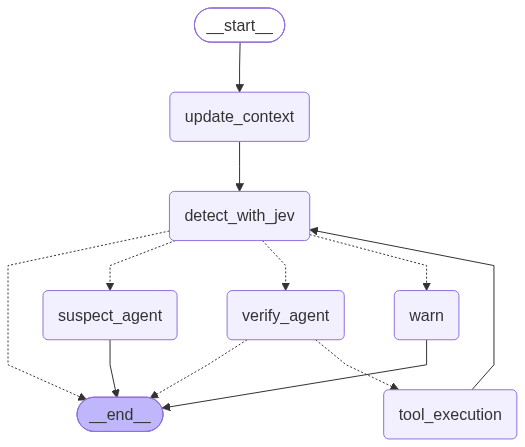

# 현재 데모 구성

상태: 2026-10-12 데모 구현·API 없는 검사·실제 Gemini 세 발화 실행 완료. 계약 기준은 [MVP 전체 스펙](../design/state-and-graph.md), 실행 근거는 [first-demo work](../../openspec/changes/first-demo/work.md)에 있다.

위 그림은 현재 `build_graph(DemoRoles())`를 컴파일한 뒤 LangGraph의 `get_graph().draw_mermaid_png()`로 추출한 실행 그래프다. 점선은 조건부 Edge이며, `tool_execution` 결과는 `detect_with_jev`로 돌아가 재판단된다.

## 구성과 책임

| 코드 | 책임 |
|---|---|
| [cli.py](../../scamshield/cli.py) | 새 callId 생성, 세 발화 순차 입력·자동 실행, Node 업데이트·결과 출력, 오류 시 시나리오 중단 |
| [graph.py](../../scamshield/graph.py) | CallDemo 입력/결과 경계, StateGraph 분기·sync checkpoint, Jev 출력/전이 검증, 요청 선택과 Tool 실행·결과 저장 분리 |
| [state.py](../../scamshield/state.py) | 기본 교체 TypedDict State·입력 channel, Pydantic 내부 계약, 고정 안내·세 발화 |
| [jev.py](../../scamshield/jev.py) | 누적 대화·이전 phase·해당 사건번호 최신 Mock 결과 기반 Fake risk/phase 판단 |
| [gemini.py](../../scamshield/gemini.py) | 같은 ChatGoogleGenerativeAI 모델의 역할별 prompt·단일 invoke, Verify Tool Calling 0/1/여러 요청 처리 |
| [roles.py](../../scamshield/roles.py) | 역할 인터페이스와 명시적인 API 없는 Agent 대역 |
| [tools.py](../../scamshield/tools.py) | case_lookup 선언과 즉시 반환 Mock 테이블 조회 |

입력은 CallDemo.run_turn(callId, utterance)에서 검증한 뒤 Graph로 전달한다. update_context가 원문을 대화에 추가하고 입력을 소비한다. detect_with_jev가 판단 후 분기하며 VERIFY는 verify_agent → tool_execution → 같은 detect_with_jev로 돌아간다. 결과 후 VERIFY가 유지되면 안내 후 종료한다. WARN은 고정 경고로 종료한다. 선택 Node에는 도구 선언만 제공하므로 모델이 Python 함수를 자동 실행하지 않는다.

CLI는 하드코딩된 DEMO_UTTERANCES를 세 차례 사용하거나 각 차례의 문장을 직접 입력받고 종료한다. Graph의 turn 횟수 제한은 없으며 같은 정상 callId로 추가 발화를 받을 수 있다. 현재 transcript는 화자 정보 없는 문자열 목록이고 상대방 AI·양쪽 화자 STT는 구현하지 않았다. Mock 함수의 등록 번호와 Fake Jev 검증 진입 조건은 [스펙](../design/state-and-graph.md#fake-jev의-데모-판단-규칙)에 명시한다.

## 상태와 한도

CallDemo마다 하나의 InMemorySaver를 사용하고 thread_id=callId로 구분한다. 같은 인스턴스에서 통화별 대화·검증 결과와 checkpoint를 유지한다. 응답·요청·검증 시도 flag는 새 turn마다 초기화하며 대화와 결과는 전체 목록으로 교체해 누적한다. 종료·중단된 통화도 프로세스 생존 동안 유지하며 프로세스 간 공유·재시작 복구·cleanup은 없다.

Graph routing과 tool_execution의 verification_attempted 검사로 turn당 Tool 최대 1회·결과 후 Jev 재판단 1회를 제한한다. Gemini는 자동 재시도 없이 Suspect 1회·Verify 1회 호출이며 Agent 실행 런타임은 후속 TODO다. CLI가 각 실행 완료를 기다리므로 별도 lock·큐·동시 처리·Tool timeout wrapper는 추가하지 않았다. 짧은 생성/선택에 맞춰 thinking_level=low와 모델 요청 timeout=120초를 사용한다. 이는 SDK 호출 대기 설정이며 Tool timeout 구현과 구분한다.

현재 Tool 실행 예외·schema 위반은 ERROR로 정규화한다. TIMEOUT은 타입/결과 해석의 후속 계약이고 현재 실행 Node는 TIMEOUT 결과를 생성하지 않는다. 전용으로 분류하지 못한 Graph/checkpoint 오류는 runtime/CALL_FAILED로 반환한다.

## 확인한 범위

[Graph 검사](../../tests/test_graph.py)·[Gemini 연결 대역 검사](../../tests/test_gemini.py)·[CLI 검사](../../tests/test_cli.py)로 준비된 세 발화·통화 유지/분리·선택 checkpoint·독립 실행·결과 해석·1회 한도를 확인했다. 설치된 Gemini SDK의 generate_content 전송을 대역으로 바꾸어 요청 선언·응답 변환도 확인했다. 이어 실제 Gemini로 확인 안내 생성·case_lookup/case_number=2026-12345 선택·독립 Mock 실행·최종 WARN을 확인했다. 현재 키의 해당 모델 호출 성공을 확인했으며 계정의 무료 한도·일반적인 안내 품질·탐지 성능을 검증한 것은 아니다. Fake 판단과 Mock 조회를 실제 기관 확인으로 설명하지 않는다.

이후 리뷰에서 사건번호 부분 문자열 통과를 수정했다. 최신 API 없는 검사는 31개이며 잘린 인자의 INVALID_OUTPUT·Tool 미실행·결과 미저장을 포함한다. 실제 Gemini 성공은 해당 수정 이전 기록이며 수정 후에는 API 없는 검사/CLI만 실행했다. 시점별 실행 근거는 work에서 구분한다.

실행 방법은 [README](../../README.md), 데모 흐름은 [mvp-flow](../design/mvp-flow.md), 후속 Agent 전환은 [스펙 TODO](../design/state-and-graph.md#todo--데모-이후-agent-실행-구조로-전환)에 있다.
