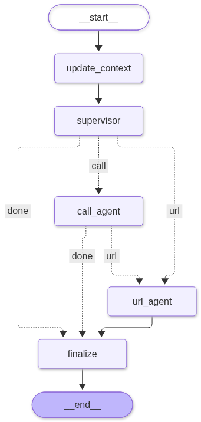
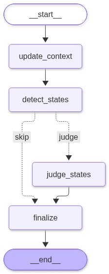

# 현재 Supervisor·상태별 판단 구성

2026-11-22 기준 Jev 상태 감지(F1~F6) → 켜진 상태별 Claude Haiku 판단 → 통화 상태·점수 계산 LangGraph를 구현했다. 이전 Jev Yes/No + Gemini 2AS를 대체한다. 계약은 [State·Graph](../design/state-and-graph.md), 실행한 검증·한계는 [jev-state-agents work](../../openspec/changes/jev-state-agents/work.md)에 있다.

2026-11-23 이 통화 그래프 위에 Jev Supervisor와 채팅 URL 에이전트를 추가했다. 기존 통화 전용 builder를 유지하면서 새 `build_supervisor_pipeline`을 제공한다. 계약은 [Supervisor·채팅](../design/supervisor-and-chat.md), 이번 검증은 [work](../../openspec/changes/jev-supervisor-url/work.md)에 있다.

통합 [Mermaid 원본](supervisor-langgraph.mmd)은 같은 offline 통화 파이프라인을 사용해 상위 Supervisor와 하위 통화 그래프를 각각 컴파일한 뒤 시각화용으로 연결한다. `call_agent` 박스 내부의 `detect_states · Jev`, `judge_states · analysis_agent · Haiku`, 통화 `finalize`가 보인다. 하위 START/END를 제외하고 상위 call 진입·url/done 복귀 간선을 연결하며 내부 skip 분기도 유지한다. 실행 그래프는 변경하지 않는다. `--supervisor --compact`는 접은 보기를 별도 파일로 출력한다. 모델 호출은 없다. URL 경로는 Mock 조회 결과를 별도로 돌려준다.

이 이미지는 [export_graph.py](../../scamshield/export_graph.py)가 실제 `build_graph(OfflineDetector(), OfflineAnalyst())`를 컴파일한 뒤 추출한다. 대역과 실제 모델이 같은 Graph를 사용하며 내보내는 동안 모델 호출은 없다. [Mermaid 원본](scamshield-langgraph.mmd)도 함께 저장한다.

## 코드와 책임

| 코드 | 책임 |
|---|---|
| [state.py](../../scamshield/state.py) | 통화/채팅 입력·출력·메모리·처리 영수증·URL 결과·`PipelineError` |
| [supervisor.py](../../scamshield/agents/supervisor.py) | 상위 그래프, Jev 라우팅, 메시지 ID 처리 상태, URL 캐시 |
| [call_agent.py](../../scamshield/agents/call_agent.py) | 기존 통화 그래프, 동시 판단·보정·점수·통화 상태 |
| [jev_agent.py](../../scamshield/agents/jev_agent.py) | Jev Supervisor 질문과 F1~F6 감지, HTTP·choice 검증 |
| [analysis_agent.py](../../scamshield/agents/analysis_agent.py) | Haiku 상태별 맥락 분석·대응·F1/F3 Tool Calling |
| [url_agent.py](../../scamshield/agents/url_agent.py) | URL 추출·정규화·전용 Tool Calling·Mock 조회 인터페이스 |
| [interfaces.py](../../scamshield/agents/interfaces.py) | 역할별 Protocol, 키 없는 통화 대역 |
| [llm.py](../../scamshield/llm.py) | 두 Haiku 에이전트가 공유하는 전송·timeout·오류 분류 |
| [context.py](../../scamshield/context.py) | 전체 이력의 원래 seq·지문 대응과 선택 근거 검증 |
| [recovery.py](../../scamshield/recovery.py) | 통화 감지·상태 분석의 최대 3회 재시도와 진행 이벤트 |
| [tactics.py](../../scamshield/tactics.py) | 상태 F1~F6 정의, 우선순위·보류 기준·절대선 상태·점수 |
| [tools.py](../../scamshield/tools.py) | F1·F3·URL Mock tool(고정 목록) |
| [graph.py](../../scamshield/graph.py) | 기존 BE import와 새 Supervisor builder의 공개 진입점 |
| [cli.py](../../scamshield/cli.py) | 여러 요청을 이어 보내는 데모 입력과 결과 출력 |
| [export_graph.py](../../scamshield/export_graph.py) | 컴파일된 그래프의 Mermaid·PNG 출력 |

## 수명과 범위

두 `analyze`는 상태를 저장하지 않는다. 통화/채팅 원문·메시지 ID·최신 state는 BE가 저장해 다음 요청에 돌려준다. Supervisor state에는 대화 원문 대신 통화 분석 메모리·채팅 해시/완료 플래그·URL 결과를 담는다. 기존 BE 연결은 통화 전용이며 새 Supervisor 연결과 원자적 저장·방 단위 직렬화는 후속이다. tool은 Mock이고 실제 조회 API는 없다. 실행 방법은 [README](../../README.md)에 있다.

## 검증

2026-11-28 분석 실패 대응을 agent에 추가했다. 전체 대화에서 직접/보조 근거를 선택하고, 실패한 작업만 같은 문맥으로 최대 3회 추가 재시도한다. 진행 콜백·최종 실패·nullable 점수와 이전 위험 보존은 [통화 계약](../design/state-and-graph.md), 검증과 BE·프론트 미연결 범위는 [현재 work](../../openspec/changes/analysis-failure-handling/work.md)에 있다.

API 없는 Graph·Jev HTTP·Haiku 요청·Mock tool·CLI 검사는 [tests](../../tests/test_graph.py)에 연결된 테스트 모음으로 확인한다. 실제 Jev·Haiku 연결과 KorCCVi 평가는 아직이며 결과는 [work](../../openspec/changes/jev-state-agents/work.md)에 구분해 남긴다.
