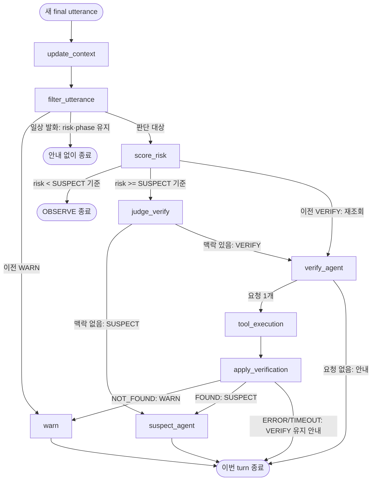

# 벡터 유사도 위험 점수와 VERIFY 판단

상태: **초안 — 구현 전**. 근거: 2026-10-16 사용자가 위험 점수를 보이스피싱범 데이터셋의 벡터 유사도로 산출하고, Jev는 SUSPECT 이상일 때 VERIFY 맥락만 판단하도록 방향을 정했다. 이어서 사기·정상 유사도 차이 점수와 Jev 일상 발화 필터를 채택했다. 조회 결과 반영은 규칙으로, 통화 누적 검색은 최근 N개 발화 window로, 점수 결합은 감쇠 최댓값으로, Jev 호출은 SUSPECT 기준 이상의 판단 대상 발화마다로 정했다. top-k 집계는 top-5 평균 차이 + clip, 임베딩은 768차원 SEMANTIC_SIMILARITY로 정했다. **모든 수치는 확정값이 아니며, 여러 값을 넣어 비교하는 수치 탐색을 거쳐야 한다**([수치 탐색](#수치-탐색--필수)). 진행은 [vector-risk-scoring change](../../openspec/changes/vector-risk-scoring/work.md)에 있다.

## 목적과 범위

[MVP 전체 스펙](state-and-graph.md)의 Jev는 risk와 phase를 모두 판단한다. 현재 구현은 정해진 데모 문장에만 반응하는 Fake Jev다. 이 문서는 판단을 네 단계로 나눈다.

| 단계 | 결정하는 것 | 근거 | 교체 경계 |
|---|---|---|---|
| 발화 필터 | 이번 발화를 점수에 반영할지 | 최근 대화 맥락에서 이번 발화가 판단과 무관한 일상 발화인지 | `UtteranceFilter` port |
| 위험 점수 | risk, OBSERVE/SUSPECT | 사기·정상 발화 데이터셋과의 유사도 차이(사기 − 정상) + 기존 누적 점수 | `RiskScorer` port |
| VERIFY 판단 | SUSPECT/VERIFY | 대화에 검증 가능한 정보와 검증 필요성이 있는지 | `VerifyJudge` port |
| 조회 결과 반영 | WARN/SUSPECT/VERIFY 확정 | 이번 turn의 Verification Tool 결과 | Graph Node(규칙) |

일상 발화로 걸러지면 점수를 계산하지 않는다. 점수가 SUSPECT 기준 미만이면 VERIFY 판단을 호출하지 않는다. 발화 필터·위험 점수·VERIFY 판단은 port/adapter로 분리해 벡터 검색·Jev 외의 API나 ML 모델로 교체할 수 있게 한다. 분류 모델 학습·데이터셋 수집·threshold 보정 실험 자체는 이 문서의 범위가 아니다.

State·checkpoint·Agent·Tool·turn당 Tool 1회·WARN 하향 금지 등 공통 규칙은 [MVP 전체 스펙](state-and-graph.md)을 그대로 따른다.

## 구조와 책임



| Node | 읽기 | 쓰기·동작 |
|---|---|---|
| filter_utterance | 이번 발화·최근 transcript·phase | 이전 WARN이면 필터 없이 warn. 그 외 `UtteranceFilter` 호출 → 일상 발화면 State를 바꾸지 않고 종료 |
| score_risk | 이번 발화·전체 transcript·이전 risk | `RiskScorer` 호출 → risk 적용, 기준과 비교해 OBSERVE 또는 다음 단계 |
| judge_verify | 전체 transcript·phase·검증 결과 | `VerifyJudge` 호출 → VERIFY 또는 SUSPECT. 이전 VERIFY면 호출하지 않음 |
| suspect_agent | 기존과 동일 | 경고·확인 행동 안내 생성 |
| verify_agent·tool_execution | 기존과 동일 | Tool 선택·실행·결과 저장 |
| apply_verification | 이번 turn 검증 결과·risk | 아래 규칙으로 phase·risk 확정 |

기존 `detect_with_jev` 한 Node가 하던 최초 판단과 재판단을 filter_utterance·score_risk·judge_verify·apply_verification으로 나눈다. Tool 결과 뒤 Jev를 다시 호출하지 않으므로 verification_attempted는 같은 turn의 두 번째 Tool 실행을 막는 용도로만 남는다.

## 입력·출력·상태 갱신

### UtteranceFilter port

2026-10-16 사용자 채택: Jev가 평범하거나 일상적인 발화를 걸러 점수 반영 없이 넘기고, 걸러진 발화에는 안내 없이 이번 turn을 끝낸다.

| 구분 | 내부 계약 |
|---|---|
| 입력 | utterance: 이번 발화, context: 이번 발화 직전의 최근 대화(개수 미정), phase |
| 출력 | `FilterDecision{is_routine: bool, confidence: 0~1 또는 None}` |
| 적용 | is_routine=true이면 risk·phase를 바꾸지 않고 response=None으로 종료 |
| 실패 | 호출·출력 검증 오류를 실행 오류(stage=`filter`)로 반환, 자동 재시도 없음 |

- 걸러진 발화도 update_context가 이미 transcript에 넣었으므로 그대로 남는다. 통화 누적 검색·VERIFY 판단·Agent는 걸러진 발화까지 포함한 전체 대화를 본다. 기관 사칭 도입부처럼 단독으로는 평범하지만 뒤 발화와 이어지면 의미가 생기는 말을 잃지 않기 위해서다.
- 발화만 보고 판단하지 않고 최근 대화를 함께 넘긴다. 같은 「계좌번호 불러주세요」도 맥락에 따라 의미가 다르다.
- 판단 기준은 "이 맥락에서 이번 발화가 사기 위험 판단에 새 정보를 주지 않는가"다. 기관·금전·개인정보·긴급성·검증 대상이 나오면 일상 발화가 아니다. 애매하면 판단 대상으로 둔다(놓치는 것보다 점수 계산을 한 번 더 하는 편이 안전하다).
- adapter: TypeSafe Jev(키 발급 후, Boolean 질문), Fake(짧은 인사·맞장구 목록과 일치할 때만 true).

### Jev 질문과 confidence 기준

2026-10-16 사용자 채택. Jev의 주 학습 언어가 영어이므로 대화(state)는 한국어 그대로 넘기고 질문만 영어로 쓴다. 아래 문구는 에이전트 초안이며 키 발급 후 실제 응답으로 다듬는다. `is_routine`·`should_verify`는 phase가 아니라 각 port 출력의 판단 값이며 State에 저장하지 않는다.

| 답 이름 | 사용 Node | 질문 초안 |
|---|---|---|
| `is_routine` | filter_utterance | Given the recent conversation, does the latest utterance add NO new information for judging phone-scam risk? (greetings, backchannels like '네네', small talk). Answer false if it mentions an institution, money, account, personal info, urgency, or something verifiable. |
| `should_verify` | judge_verify | Does the conversation contain a verifiable target (case number, institution phone number, account) AND is the other party using it to demand an action, so the user needs to check it? A number merely appearing is not enough. |

| 적용 | 규칙 | 이유 |
|---|---|---|
| 필터 | `is_routine=true`이고 confidence ≥ `routine_min_confidence`(초기 0.8)일 때만 거른다 | 위험 발화를 잘못 거르는 비용이 크다 |
| VERIFY | `should_verify=true`이고 confidence ≥ `verify_min_confidence`(초기 0.5)이면 VERIFY | 잘못된 VERIFY는 조회 한 번, 놓친 VERIFY는 WARN 누락 |
| confidence None | Boolean 값만 쓴다 | confidence를 주지 않는 adapter도 교체 가능하게 |

기준값은 adapter가 아니라 Graph 설정에 둔다. suspect_threshold와 같이 모델을 바꿔도 정책이 한 곳에 남게 하기 위해서다.

### RiskScorer port

| 구분 | 내부 계약 |
|---|---|
| 입력 | utterance: 이번 발화, transcript: 이번 발화를 포함한 전체 목록, previous_risk: float 또는 None |
| 출력 | `RiskScore{risk, utterance_score, call_score}` — 모두 유한한 0~1 |
| 실패 | 호출·출력 검증 오류를 실행 오류(stage=`risk`)로 반환, 자동 재시도 없음 |

phase 결정은 port 밖 score_risk Node가 `risk >= suspect_threshold`로 한다. adapter는 점수만 반환하고 phase를 고르지 않는다. 그래야 다른 모델로 바꿔도 threshold 정책이 한 곳에 남는다.

**벡터 유사도 adapter** (`VectorRiskScorer`)는 두 검색을 한다.

1. **이번 발화 검색**: utterance를 임베딩해 데이터셋에서 top-k를 찾고 점수를 낸다 → utterance_score.
2. **통화 누적 검색**: 통화 대화를 하나의 query로 임베딩해 top-k를 찾고 점수를 낸다 → call_score. query는 transcript의 최근 N개 발화를 이어 붙인 window다(2026-10-16 사용자 채택, 초기 N=5). 전체 transcript는 통화가 길어질수록 의미가 흐려지고 임베딩 입력 한도에 걸려 쓰지 않는다. 데이터셋은 발화 단위로 적재하므로 window query와 길이가 다르다. window 단위 적재 여부는 실험으로 정한다.

각 검색의 점수는 **사기 유사도와 정상 유사도의 차이**다(2026-10-16 사용자 채택, (b)안). label=scam 문장의 top-k 유사도 집계에서 label=normal 문장의 top-k 유사도 집계를 빼고 0~1로 변환한다(아래 계산식). 코사인 유사도의 절댓값은 한국어 문장끼리 대체로 높아 그대로 위험도로 쓰기 어렵기 때문이다. 인사말처럼 사기·정상 통화에 모두 흔한 문장은 두 유사도가 비슷해 점수가 낮게 나온다.

2026-10-16 사용자 채택 계산식(수치는 초기값):

```
scam_sim   = label=scam top-k 유사도 평균        (초기 k = 5)
normal_sim = label=normal top-k 유사도 평균      (초기 k = 5)
d          = scam_sim − normal_sim
score      = clip(d / d_scale, 0, 1)             (초기 d_scale = 0.1)
```

- 평균: 최댓값은 우연히 비슷한 문장 하나나 같은 통화의 중복 문장에 크게 흔들린다.
- clip: 범위를 벗어난 값을 끝값으로 자른다. d ≤ 0(정상 통화에 같거나 더 가까움)은 0점, d ≥ d_scale은 1점이다. sigmoid보다 정할 값이 하나 적고 설명이 쉽다.
- d_scale·suspect_threshold는 적재 후 데이터셋에서 뺀 사기·정상 통화의 d 분포를 측정해 정한다.

검토한 대안: (a) 사기 데이터만 넣고 실측 분포로 정규화 — 정상 통화 기준이 없어 기준값의 의미가 약하다. (c) top-k 중 사기 문장 비율(kNN 투표) — 데이터 양의 쏠림에 민감하다.

risk는 previous_risk·utterance_score·call_score를 아래처럼 결합한다(2026-10-16 사용자 채택).

```
turn_score = w · utterance_score + (1 − w) · call_score        (초기 w = 0.5)
risk       = max(previous_risk × decay, turn_score)             (초기 decay = 0.9)
```

- 기존 누적 점수를 감쇠해 유지하므로 위험 발화 뒤 평범한 발화가 이어져도 점수가 바로 사라지지 않는다. 위험 발화가 계속 없으면 risk가 조금씩 내려가 SUSPECT → OBSERVE로 돌아갈 수 있다. 오탐 한 번으로 통화 끝까지 SUSPECT에 머무는 것을 피하기 위해서다.
- 이전 phase가 VERIFY 또는 WARN이면 감쇠하지 않고(`decay = 1`) phase도 내리지 않는다. WARN 하향 금지와 "VERIFY는 risk ≥ suspect_threshold" 정책을 지키고, 조회 흐름이 점수 변동으로 끊기지 않게 한다.
- w·decay·N은 설정값이다. 위 초기값은 에이전트 초안이며 실험으로 조정한다.

내부 의존성도 테스트 대역을 위해 작은 Protocol로 둔다.

| Protocol | 역할 | 실제 adapter | 테스트 대역 |
|---|---|---|---|
| `Embedder` | texts → 벡터 목록 | Gemini embedding | 고정 벡터 Fake |
| `ScamVectorStore` | 벡터, label, k → `[Match{text, similarity, source_id, label}]` | pgvector | In-memory 코사인 검색 |

### VerifyJudge port

| 구분 | 내부 계약 |
|---|---|
| 입력 | transcript: 전체 목록, phase: 이번 turn의 phase(SUSPECT 이상), verification_results: 누적 목록 |
| 출력 | `VerifyDecision{should_verify: bool, confidence: 0~1 또는 None}` |
| 적용 | judge_verify가 should_verify=true이면 VERIFY, 아니면 SUSPECT |
| 실패 | 호출·출력 검증 오류를 실행 오류(stage=`verify_judge`)로 반환, 자동 재시도 없음 |

호출 시점(2026-10-16 사용자 채택):

- 이전 phase가 OBSERVE·SUSPECT이고 risk ≥ suspect_threshold인 판단 대상 발화마다 호출한다. 점수가 그대로인 채 사건번호·계좌번호 같은 검증 정보가 뒤에 나와도 놓치지 않기 위해서다. 일상 발화는 filter_utterance가 먼저 걸러 호출 수를 줄인다.
- 이전 phase가 VERIFY(조회 ERROR/TIMEOUT 뒤)이면 호출하지 않고 score_risk에서 verify_agent로 바로 가서 다시 조회한다. turn당 Tool 1회는 유지한다.
- FOUND로 SUSPECT가 된 뒤에도 같은 통화에서 다시 VERIFY할 수 있다. 사기범이 다른 사건번호·계좌번호로 바꿔 말하는 경우를 막는다.
- VERIFY에는 risk ≥ suspect_threshold를 요구한다. 기존 "risk ≥ 0.6"은 Fake Jev 데모 값이어서 threshold를 설정 한 곳에서 관리하도록 바꾼다.

판단 기준은 기존 Jev 스펙의 VERIFY 조건과 같다. 사건번호·기관 연락처·계좌처럼 **검증 가능한 대상**이 있고, 상대가 이를 근거로 행동을 요구해 **확인할 필요**가 있을 때만 true다. 번호가 등장했다는 사실만으로 true가 되지 않는다.

| adapter | 상태 |
|---|---|
| TypeSafe Jev (`jev-latest`) | API 키 발급 후 구현·검증. Boolean 질문으로 should_verify를, 응답 confidence로 confidence를 채운다. 주 학습 언어가 영어이므로 대화는 한국어 그대로 두고 질문·기준 설명은 영어로 작성한다 |
| Fake | 키 없이 쓰는 데모·테스트용 규칙. 현재 Fake Jev의 사건번호 진입 조건을 옮긴다 |

Gemini 등 다른 LLM을 대체 adapter로 추가할 수 있지만 이번 범위에서 필수는 아니다.

### State 변경

ScamState 필드는 추가하지 않는다. risk의 의미만 "Jev가 반환한 위험도"에서 "RiskScorer가 계산한 통화 누적 위험 점수"로 바뀐다. utterance_score·call_score·top-k 근거 문장은 이번 범위에서 State에 저장하지 않는다. UI 표시나 디버깅에 필요해지면 그때 추가한다.

score_risk는 update_context가 utterance를 소비하기 전 값이 필요하다. 이번 발화는 갱신된 transcript의 마지막 항목으로 읽는다. 입력 경계와 소비 규칙은 바꾸지 않는다.

### 조회 결과 반영 규칙

2026-10-16 사용자 채택: Tool 결과 뒤 Jev를 다시 호출하지 않고 apply_verification이 규칙으로 반영한다. 결과가 사실상 세 종류이고, WARN처럼 결과가 큰 결정을 같은 입력에 같은 결과로 확인할 수 있어야 하기 때문이다.

| 이번 turn 결과 | phase | risk | 다음 |
|---|---|---|---|
| status=OK, lookup_status=NOT_FOUND | WARN | `max(risk, warn_risk_floor)` | warn 고정 경고 |
| status=OK, lookup_status=FOUND | SUSPECT | 유지 | suspect_agent가 "실제 사건이 있어도 공식 대표번호로 직접 확인" 안내 |
| status=ERROR 또는 TIMEOUT | VERIFY 유지 | 유지 | 기존 VERIFY 종료 안내(조회하지 못함, 직접 확인). 다음 발화에서 다시 조회 가능 |

- FOUND는 first-demo에서 에이전트가 Mock 내부 초안으로 추가한 결과다. 실제 조회에서도 사건 있음 결과는 생기므로 사용자 결정으로 유지한다. 사기범이 실제 사건번호를 도용할 수 있어 FOUND를 안전으로 보지 않고 OBSERVE로 내리지 않는다.
- warn_risk_floor는 WARN과 risk 표시가 어긋나지 않게 하는 하한이다. 초기값 0.9이며 설정으로 바꿀 수 있다.
- 판단은 이번 turn에 저장한 결과 하나만 본다. 이전 turn의 결과로 다시 WARN을 내리지 않는다.
- Mock NOT_FOUND로 WARN을 내리는 것은 데모 규칙이다. 실제 기관 미등록 판정이 아니다.

## 데이터셋 적재

| 항목 | 기준 |
|---|---|
| 원본 | 기본 후보 [KorCCVi v2](https://github.com/selfcontrol7/Korean_Voice_Phishing_Detection): 금융감독원 사기 통화와 AI Hub 정상 통화의 발화 단위 전사·화자 구분. 실제 기관의 정상 통화처럼 사기와 비슷한 정상 예시를 보완용으로 추가할 수 있다. 사용 조건(`DATA.md`)·개인정보 제거 여부를 적재 전에 기록 |
| 적재 단위 | 문장 또는 짧은 발화 단위. 긴 통화문은 문장 단위로 나눈다 |
| 적재 형식 | JSONL `{source_id, text, label: scam/normal, speaker}`. 사기 통화는 사기범 쪽 발화만 넣는다 |
| 저장 | PostgreSQL + pgvector 테이블 `call_utterances(id, source_id, label, speaker, text, embedding vector(D))`, 코사인 거리 인덱스 |
| 실행 | 데이터셋 → 임베딩 → 적재를 한 번 수행하는 별도 스크립트. 통화 Graph는 검색만 한다 |
| 로컬 환경 | Docker의 pgvector 이미지. 접속 정보는 `.env`(DATABASE_URL)로 받고 문서에 적지 않는다 |

임베딩 설정(2026-10-16 사용자 채택, 초기값): `gemini-embedding-001`, 768차원, task type `SEMANTIC_SIMILARITY`(적재·검색 같은 값). 발화끼리 비교하는 대칭 유사도이기 때문이다. 3072가 아닌 차원은 출력이 정규화되어 있지 않으므로 저장·검색 전에 직접 정규화한다. 기본 3072차원은 pgvector HNSW 한도(2000)를 넘는다.

적재와 검색은 같은 임베딩 모델·차원을 사용해야 한다. 모델이나 차원을 바꾸면 전체를 다시 적재한다.

## 정상 흐름과 종료·실패 처리

데모 세 발화의 기대 흐름은 다음과 같다. 수치는 Fake 대역 기준이며 실제 데이터셋 결과를 주장하지 않는다.

| 발화 | filter | score_risk | judge_verify | 결과 |
|---|---|---|---|---|
| 「서울중앙지검입니다.」 | 판단 대상 | 기준 미만 | 호출 안 함 | OBSERVE, 안내 없음 |
| 「고객님 계좌가 범죄에 연루됐습니다.」 | 판단 대상 | 기준 이상 | 맥락 없음 | SUSPECT, 확인 안내 |
| 「사건번호는 2026-12345입니다.」 | 판단 대상 | 기준 이상 | 맥락 있음 | VERIFY → case_lookup → NOT_FOUND → WARN |
| (추가 검사) SUSPECT 중 「네네」 | 일상 발화 | 호출 안 함 | 호출 안 함 | SUSPECT 유지, 안내 없음 |

- 이전 phase가 WARN이면 score_risk가 WARN을 유지하고 warn으로 간다. 점수 하락으로 WARN을 내리지 않는다.
- UtteranceFilter·RiskScorer·VerifyJudge 실패는 기존 Jev 실패와 같이 이번 실행의 오류로 반환한다. 데모에서는 새 callId로 재시작한다.
- Tool ERROR/TIMEOUT은 기존처럼 결과로 저장한다. WARN을 강제하지 않는다.

## 검증할 동작

- API·DB 없는 테스트: Fake Filter·Fake Embedder·In-memory store·Fake VerifyJudge로 세 발화 흐름, WARN 유지, turn당 Tool 1회, SUSPECT 미만에서 VerifyJudge 미호출, 일상 발화의 State 불변·transcript 보존·안내 없음을 확인한다.
- port 교체: Graph가 `UtteranceFilter`·`RiskScorer`·`VerifyJudge` 구현을 주입받고, 다른 구현으로 바꿔도 Graph 코드를 고치지 않는다.
- 실제 연결: 로컬 pgvector에 샘플 데이터셋을 적재하고 Gemini embedding으로 검색·점수를 산출해 결과를 기록한다. 탐지 성능은 주장하지 않는다.
- Jev: 키 발급 후 별도로 실제 호출을 검증하며, 그 전에는 Fake로만 검증했다고 구분한다.

## 수치 탐색 — 필수

2026-10-16 사용자 지시: **아래 값들은 아직 확정이 아니다. 여러 수치를 넣어 비교하고 좋은 수치를 찾는 과정이 반드시 필요하다.** 문서의 초기값은 구현을 시작하기 위한 출발점일 뿐이며, 탐색 없이 초기값을 최종값으로 쓰거나 "보정 완료"로 표시하지 않는다.

| 값 | 초기값 | 탐색 후보(예) | 정하는 근거 |
|---|---|---|---|
| k (top-k) | 5 | 3·5·10·20 | 사기·정상 점수 분포의 분리 정도 |
| d_scale | 0.1 | 측정한 d의 80·90·95번째 백분위 | 사기 발화 점수가 0~1에 고르게 퍼지는지 |
| suspect_threshold | 미정 | 정상 통화 점수 분포의 여러 백분위 | 정상 통화 오탐률과 사기 통화 탐지율 |
| w | 0.5 | 0.3·0.5·0.7 | 발화 점수와 누적 점수의 기여 비교 |
| decay | 0.9 | 0.8·0.9·0.95·1.0 | 오탐 뒤 OBSERVE 복귀 속도와 탐지 유지 |
| N (window) | 5 | 3·5·8 | 통화 누적 점수의 안정성 |
| 필터 최근 대화 개수 | 미정 | 3·5 | 필터 판단 정확도와 입력 길이 |
| routine_min_confidence | 0.8 | 0.6·0.7·0.8·0.9 | 위험 발화를 일상으로 잘못 거른 비율 |
| verify_min_confidence | 0.5 | 0.3·0.5·0.7 | 불필요한 조회와 놓친 VERIFY 비율 |
| 임베딩 차원 | 768 | 768·1536 | 같은 평가에서 분리 정도 차이 |
| 집계·변환 방식 | 평균·clip | 최댓값·상위 가중 평균, sigmoid | 위와 같은 평가에서 비교 |

- 평가 데이터는 적재에 쓰지 않은 통화로 나눈다. 같은 통화의 발화가 적재와 평가에 함께 들어가면 점수가 부풀려진다.
- 모든 값은 코드에 고정하지 않고 설정으로 받는다. 탐색 실험은 설정만 바꿔 반복 실행할 수 있어야 한다.
- 실험 조건·결과·선택 이유는 [분석 문서](../analysis/index.md)에 기록하고, 정한 값을 이 문서에 반영한다.
- KorCCVi v2는 사기·정상의 출처가 달라 전사 스타일 차이가 점수에 섞일 수 있다. 탐색 결과를 실제 통화 성능으로 주장하지 않는다.

## 미확정 사항

| 항목 | 후보 | 비고 |
|---|---|---|
| 데이터셋 사용 조건 | KorCCVi v2 `DATA.md` 확인 | 사기=금감원, 정상=AI Hub로 출처와 label이 완전히 겹쳐 전사 스타일 차이가 점수에 섞일 수 있음(저자 명시 한계) |

## 관련 문서

- [MVP 전체 스펙](state-and-graph.md) — 공통 State·Graph·Agent·Tool 계약과 현재 Jev 계약
- [프로젝트 컨텍스트](../project-context.md)
- [vector-risk-scoring change](../../openspec/changes/vector-risk-scoring/proposal.md) · [작업 기록](../../openspec/changes/vector-risk-scoring/work.md)
- [TypeSafe Quick start](https://docs.typesafe.ai/introduction/quickstart) · [Pydantic AI TypeSafe 모델](https://pydantic.dev/docs/ai/models/typesafe/) — Jev 질문 형식·confidence·한국어 한계
- [Gemini Embedding GA 안내](https://developers.googleblog.com/en/gemini-embedding-available-gemini-api/) — 차원 축소(MRL)·무료 티어

외부 문서 확인일: 2026-10-16. 무료 한도·가격·모델 ID는 구현 시점에 다시 확인한다.
