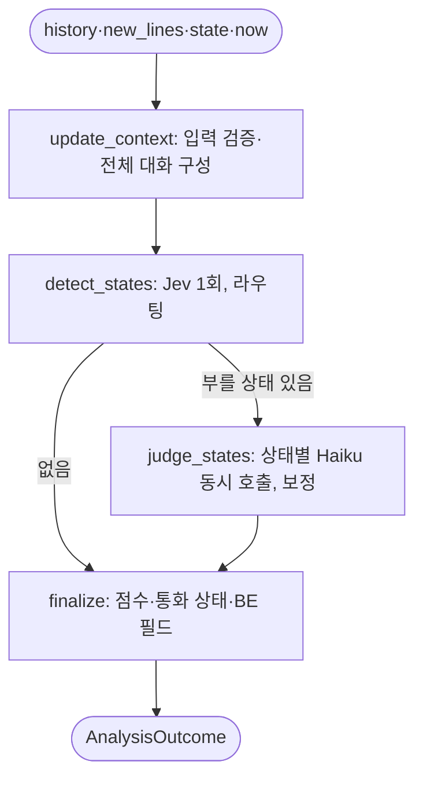

# ScamShield 상태별 판단 State·Graph 계약

상태: **2026-11-22 [jev-state-agents](../../openspec/changes/jev-state-agents/design.md#구현-계약-2026-11-22) 구현 계약대로 구현, API 없는 테스트 통과**. 실제 Jev 6질문·Haiku 연결은 아직 확인하지 않았다. 이전 Jev Yes/No + Gemini 2AS 계약을 대체한다. 2AS의 요구와 검증 기록은 [2AS change](../../openspec/changes/jev-gemini-two-agent/work.md)에 보존한다.

## 목적과 범위

통화의 새 줄이 들어오면 Jev가 사기 수법 행동 F1~F6이 새 줄에 나타났는지 감지하고, 켜진 상태마다 Claude Haiku가 대화 맥락으로 그 행동이 수상한지 판단한다. 상태 판단으로 통화 상태(위험·주의·정상)와 점수를 정한다. 상태 정의는 [spec](../../openspec/changes/jev-state-agents/spec.md#상태-정의)에 있다. STT·화자 구분·BE 저장은 BE `agent-bridge`가 맡는다.

## 실행 구조

통화 전용 입구는 [graph.py](../../scamshield/graph.py)의 `CallPipeline.analyze(history, new_lines, state, now)`이며 구현은 [call_agent.py](../../scamshield/agents/call_agent.py)에 있다. 2026-11-23 별도 상위 [Supervisor·채팅 입구](supervisor-and-chat.md)를 추가했으며 이 통화 API도 유지한다. 통화 상태는 입력 `state`로만 받고 출력 `state`로 돌려주므로 checkpointer가 없다. 같은 요청을 같은 `state`로 다시 보내면 점수가 중복 누적되지는 않지만 모델 호출 자체가 중복될 수 있다. 서버가 history와 state를 저장하고 다음 요청에 다시 보내야 한다. `build_pipeline(offline=False)`는 `TYPESAFE_API_KEY`·`ANTHROPIC_API_KEY`가 비어 있으면 `PipelineError(code="config")`를 낸다. `offline=True`는 키 없는 고정 대역이다.

## 입력과 출력

- `history: list[str]`: 이번 요청 전 대화. 한 줄은 `"[화자] 발화"`다. `[ ]` 안은 화자로, BE 통화방에서는 참가자 id(`[p1]` 등)다. 누가 앱 사용자인지는 표시하지 않는다. `[사용자 입력 …]`은 참가자가 앱에 넣은 내용이다. 로컬 CLI·테스트는 `[나]`·`[상대]`도 쓴다.
- `new_lines: list[NewLine]`: 이번 새 줄 `{seq, text}`. 1줄 이상이다.
- `state: dict | None`: 이전 출력의 `state`. `None`이면 새 통화다.
- `now: float`: 새 줄의 시각(초). `uncertain` 점수 감소를 잰다.

`AnalysisOutcome`([state.py](../../scamshield/state.py))

| 필드 | 의미 |
|---|---|
| `status` | `risky` 상태가 있으면 위험, 없고 점수가 남은 `uncertain`이 있으면 주의, 그 밖은 정상 |
| `score` | 상태별 점수 칸의 합(최대 100) |
| `message` | 위험일 때 가장 최근에 `risky`가 된 상태의 `response`(같은 요청에서 여럿이면 우선순위가 가장 높은 것). 비었으면 고정 문구. 위험이 아니면 `None` |
| `reason` | 사용자 화면의 근거. `message`와 같은 상태의 이유 한 문장(`risky`가 없으면 점수가 남은 `uncertain` 중 우선순위가 가장 높은 상태). 상태 코드는 붙이지 않는다. 없으면 `None` |
| `evidence_seqs` | `risky` 상태를 판단한 요청의 새 줄 `seq`(보류였으면 보류 동안 쌓인 `seq`) |
| `states` | 이번 Jev 결과. 상태별 `{verdict, probability(P(Yes))}` |
| `state_analyses` | 이번에 부른 Haiku의 보정 후 판단(우선순위 순). 보정 전 판단·보정 이유·tool 결과 상태를 함께 남긴다 |
| `state` | 다음 요청에 넘길 JSON dict: `handled`(상태별 `{judgment, reason, response, actions, evidence_seqs, judged_at}`), `call_context`(`{purpose, claimed_identity}`), `seen`, `held`(F3·F5 `{probability, seqs, lines}`, `lines`는 대화상 줄 번호) |

## Jev 상태 감지

[jev_agent.py](../../scamshield/agents/jev_agent.py)는 통화 분석 요청마다 `POST /v1/systemone`을 1번 부른다. `history` 마지막 4줄과 새 줄 전부를 보내고, 상태 6개를 choice 질문으로 묻는다. 새 줄에 `(새)` 표시를 붙여 새 대사에 행동이 있는지만 묻는다. 대기 10초, 자동 재시도는 없다. 호출 실패·잘못된 출력은 `PipelineError(stage="jev")`이며 모든 상태를 No로 바꾸지 않는다. 키·주소·모델 환경변수는 `TYPESAFE_API_KEY`·`TYPESAFE_BASE_URL`·`TYPESAFE_DEFAULT_MODEL`이다. 상위 Supervisor를 사용하면 라우팅 질문 2개를 위한 Jev 호출이 별도로 1회 추가된다.

## 라우팅

- Yes인 상태 중 이전 판단이 `risky`가 아닌 상태를 부른다. 이미 `risky`인 상태는 다시 부르지 않고, `uncertain`·`within_normal`은 다시 Yes가 되면 다시 부른다.
- 이 통화에서 F1·F2·F4·F6이 아직 켜지지 않았으면 F3·F5는 `held`에 쌓고 부르지 않는다. 그중 하나가 처음 켜진 요청에서 `held`를 모두 함께 부르고 비운다. 이때 Haiku에게는 그 상태가 감지됐던 대사 번호를 알려 준다.
- 상태들은 `ThreadPoolExecutor`로 동시에 부르고 결과는 F1 → F3 → F2 → F5 → F4 → F6 순서로 정리한다.

## 상태별 Haiku 판단

[analysis_agent.py](../../scamshield/agents/analysis_agent.py)는 [공통 Claude 전송](../../scamshield/llm.py)을 통해 `claude-haiku-5-5`, effort `low`, 호출마다 대기 12초, `max_retries=0`으로 실행한다. 입력은 전체 대화(번호 붙임), 상태 정의·절대선·판단 핵심, Jev 확률과 새 대사 번호, `call_context`, 다시 부를 때 이전 판단과 이유다. 출력은 JSON `{judgment, absolute_line, reason, response, actions, call_context}`다. 프롬프트는 상대가 주장한 신분·절차를 정상 근거로 쓰지 말고, 상대가 말한 기관·지점이 공식인지는 대화로 확인할 수 없다고 적는다.

- 보정: `absolute_line`은 F1·F2·F3·F5에서만 받아 `risky`로 고친다. tool 결과가 `flagged`면 `risky`로 고친다. 보정은 `corrections`에 남긴다.
- tool([tools.py](../../scamshield/tools.py), 고정 목록 Mock): F1 `check_account`, F3 `check_url`·`check_app`(원격제어 앱)·`check_phone`(기관 대표번호). 결과는 `flagged`/`not_found`/`error`이고 `not_found`는 안전 근거가 아니다. 대화 원문이 아니라 계좌번호·주소·앱 이름·전화번호만 넣는다. 상태당 API 호출은 tool 왕복 포함 2번까지다. 두 번째 호출은 `tool_choice: none`이고, 판단 글을 못 받아도 `flagged`가 있으면 `risky`로 둔다.
- 실패: 시간 초과·연결 실패·5xx 등 상태 코드 오류·잘못된 출력은 그 상태만 건너뛰고 오류 코드만 로그에 남긴다. 그 상태는 판단하지 않은 것으로 두고 다음 Yes에서 다시 부른다. 인증 실패(401·403)는 `PipelineError(stage="llm", code="AUTH_FAILED")`, 요청 거부(400·404)는 `llm/REQUEST_REJECTED`로 올린다.
- `call_context`는 결과의 비어 있지 않은 값으로 갱신한다.

## 점수

| 판단 | F1·F2·F3 | F5 | F4·F6 |
|---|---:|---:|---:|
| `risky` | 40 | 25 | 10 |
| `uncertain` | 20 | 10 | 5 |
| `within_normal` | 0 | 0 | 0 |

상태마다 칸이 하나다. `risky`는 고정이고, `uncertain`은 `점수 × 0.5^floor((now − judged_at) / 60)`이며 5 미만이면 0이다. 다시 판단하면 칸을 바꾸고 감소를 다시 잰다.

## 오류

`PipelineError(stage, code, message)`: `input/INVALID_INPUT`(입력·state 형식), `jev/CALL_FAILED`·`jev/INVALID_OUTPUT`, `llm/AUTH_FAILED`·`llm/REQUEST_REJECTED`, `config/config`. 키·응답 본문·대화 내용은 메시지와 로그에 넣지 않는다.

## 검증과 후속 범위

라우팅·보류·재호출, 절대선·tool 보정, 점수 감소, Haiku 실패와 인증 오류, BE 필드, `state` JSON 왕복, Jev 요청 형식, Haiku 요청·tool 왕복은 API 없는 테스트로 확인한다. 실제 Jev·Haiku 연결은 지어낸 예제 통화로 확인했고, KorCCVi 큰 표본 평가는 아직 하지 않았다. 검증 기록과 남은 일은 [work](../../openspec/changes/jev-state-agents/work.md)에 있다.

## 관련 문서

- [현재 아키텍처](../architecture/overview.md) · [입력과 실행 흐름](mvp-flow.md) · [컨텍스트](../project-context.md)
- [jev-state-agents proposal](../../openspec/changes/jev-state-agents/proposal.md) · [spec](../../openspec/changes/jev-state-agents/spec.md) · [design](../../openspec/changes/jev-state-agents/design.md) · [tasks](../../openspec/changes/jev-state-agents/tasks.md) · [work](../../openspec/changes/jev-state-agents/work.md)
- 이전 계약: [2AS change](../../openspec/changes/jev-gemini-two-agent/design.md)
- 상위 라우팅: [Supervisor 계약](supervisor-and-chat.md) · [새 change](../../openspec/changes/jev-supervisor-url/design.md)
