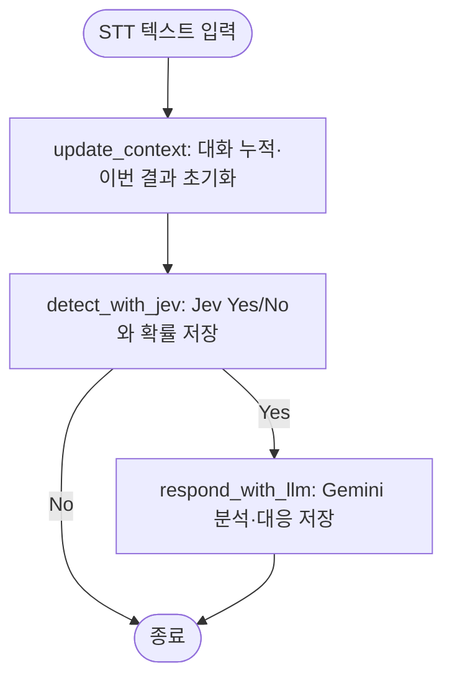

# ScamShield 2AS State·Graph 계약

상태: **2026-10-23 사용자 요청으로 구조 변경 확정, 2026-10-27 인터페이스·Graph 구현과 API 없는 검증 완료**. 실제 Jev Yes/No 연결은 확인했고 Gemini 생성 성공은 HTTP 504/503으로 미확인이다. 기존 phase·Suspect/Verify·Mock 조회 설계를 대체한다. 현재 작업과 검증 근거는 [2AS change](../../openspec/changes/jev-gemini-two-agent/work.md)에 있다. 과거 데모의 요구와 실행 이력은 [first-demo](../../openspec/changes/first-demo/work.md)에 보존한다.

## 목적과 범위

완성된 STT 텍스트를 Jev에 보내 보이스피싱 여부를 판단하고 Yes일 때만 Gemini로 분석·대응한다. 이번 범위는 두 모델의 인터페이스·실제 API 연결과 LangGraph다. 실제 STT 서비스·Kafka·화자/partial 계약·조회 도구·HTTP 서버·UI는 후속 범위다.

## 실행 구조

두 판단 역할은 Jev 탐지와 Gemini 분석·대응이다. update_context는 입력 처리 Node다. 이전 verify_agent·tool_execution·warn Node와 조회 후 Jev 재판단은 없다. 한 turn에 Jev는 1회, Gemini는 Yes이면 1회·No이면 0회다. 자동 재시도와 모델 실패 시 offline 전환은 없다.

## 인터페이스와 State

[interfaces.py](../../scamshield/interfaces.py)의 `Detector.detect(transcript)`는 판정 dict, `Analyst.analyze(state)`는 분석 dict를 반환한다. [graph.py](../../scamshield/graph.py)의 `CallPipeline(detector, analyst).run_turn(call_id, utterance)`가 입력/오류 경계다. `utterance`는 비어 있지 않은 문자열 하나이며 원문을 보존한다. callId는 thread_id로 사용하고 State에 중복 저장하지 않는다.

| State 필드 | 의미·초기화 | 작성 책임 |
|---|---|---|
| utterance | 이번 발화. 대화에 추가한 뒤 None | 입력 경계·update_context |
| transcript: list[str] | 통화 전체 텍스트. 기존 목록 + 새 발화로 전체 교체 | update_context |
| jev_decision: dict 또는 None | 이번 판정. 새 turn에는 None | 초기화·detect_with_jev |
| analysis: dict 또는 None | 이번 분석과 안내. 새 turn에는 None | 초기화·respond_with_llm |

`jev_decision = {verdict: "Yes" 또는 "No", probability: 숫자}`다. probability는 항상 **P(보이스피싱/Yes)**이며 0~1의 유한 숫자다. No의 확률이나 confidence와 혼용하지 않는다. `analysis = {reason: 문자열, response: 문자열}`이며 둘 다 공백만 있는 값을 거부한다. reason은 대화에서 확인되는 근거와 한계의 요약이고 response는 사용자 대응 안내다. Gemini가 Jev 내부 추론을 직접 알거나 기관 조회를 한 것처럼 설명하지 않는다.

기존 `phase`, `risk`, `verification_results`, `tool_request`, `verification_attempted`는 제거한다. 새 State는 기존 checkpoint와 호환되지 않는다. InMemorySaver를 새 프로세스에서 시작하고 같은 인스턴스·callId로 순차 호출할 때만 누적한다. 새 callId는 상태가 분리된다. 상태/의존성 입력/관찰 callback에는 복사본을 사용해 외부 변경을 차단한다. 영구 저장·프로세스 공유·동시 입력·cleanup은 구현하지 않는다.

## 실제 Jev 연결

2026-10-23 [TypeSafe API](https://docs.typesafe.ai/api/system-one), [Choice](https://docs.typesafe.ai/primitives/choice), [환경변수 기준](https://docs.typesafe.ai/sdk/python/api/constants)을 확인했다. [JevClient](../../scamshield/jev.py)는 표준 라이브러리 HTTP로 `POST https://api.typesafe.ai/v1/systemone`을 호출한다.

- 인증: `TYPESAFE_API_KEY`를 `Authorization: Bearer`에 전달한다.
- 기본 주소: `TYPESAFE_BASE_URL=https://api.typesafe.ai`, 기본 모델: `TYPESAFE_DEFAULT_MODEL=jev-latest`.
- 요청 state: `{transcript: 전체 텍스트 목록}`. question 이름은 `voice_phishing`, type은 `choice`, criteria는 Yes/No다.
- 응답 `answers.voice_phishing.choice`를 verdict로, `probabilities.Yes`를 probability로 변환한다. 별도 threshold로 Yes/No를 재계산하지 않는다.
- Yes/No 확률의 존재·범위·유한성·합계(오차 0.001 허용)와 최다 확률 선택을 확인한다. confidence도 API 출력 형식으로 검사하지만 보이스피싱 확률로 저장하지 않는다.
- HTTP 요청 timeout은 30초다. 호출 실패·잘못된 출력은 오류이며 No가 아니다.

## Gemini 분석·대응

[GeminiAnalyst](../../scamshield/gemini.py)는 전체 transcript와 저장된 jev_decision을 함께 전달한다. [LangChain 공식 structured output](https://docs.langchain.com/oss/python/integrations/chat/google_generative_ai#structured-output)의 `method="json_schema"`로 `reason/response`를 받는다. Tool을 bind하거나 실행하지 않는다.

`GEMINI_API_KEY`와 선택적인 `GEMINI_MODEL`을 사용한다. 기존 기본값 gemini-3.8-flash·Developer API·max_retries=0·timeout=120초·thinking_level=low를 유지한다. 모델 설정과 키 확인은 첫 Yes 때만 하므로 No 경로는 Gemini 키가 없어도 동작한다. Gemini가 Jev 판정을 다시 덮어쓰지 않는다.

## 종료와 오류

정상 결과는 `{callId, jev_decision, analysis}`다. No는 analysis=None으로 즉시 종료하며 이전 Yes의 안내를 재사용하지 않는다. Yes는 검증된 분석을 State에 저장한 뒤 종료한다. 매번 누적 transcript로 새 판단을 받으므로 이전 Yes 뒤 No도 허용한다.

오류 결과는 `{callId, error: {stage, code, message}}`다. stage는 input/jev/llm/runtime이며 잘못된 입력은 State 변경 전에 거부한다. MISSING_API_KEY·INVALID_CONFIG·INVALID_OUTPUT·CALL_FAILED·EXECUTION_CONTRACT_VIOLATION을 구분한다. HTTP 코드·상태 같은 진단은 표시하되 키·응답 본문·인증 header·원시 예외 메시지는 출력하지 않는다.

실패한 Graph에는 성공 결과가 없다. 같은 callId의 pending Node를 재개하지 않고 새 callId로 다시 시작한다. 마지막 성공의 판정/안내가 이번 실패의 결과로 반환되지 않는다.

## 검증과 후속 범위

Yes/No 분기·이전 안내 초기화·대화 누적/통화 분리·입출력 검증·실제 Jev payload·Gemini SDK 요청/응답 변환은 API 없는 테스트로 검사한다. 실제 연결은 예제 통화로 별도 확인한다. 이 검증은 보이스피싱 탐지 성능·확률 보정·안내 품질의 평가가 아니다. 한국어 STT 제품·화자·partial/재전송 계약, 서버 전송, 도구 조회, 영구 기록·운영 복구는 후속 작업이다.

## 관련 문서

- [현재 아키텍처](../architecture/overview.md) · [입력 예제 흐름](mvp-flow.md) · [컨텍스트](../project-context.md)
- [2AS proposal](../../openspec/changes/jev-gemini-two-agent/proposal.md) · [spec](../../openspec/changes/jev-gemini-two-agent/spec.md) · [design](../../openspec/changes/jev-gemini-two-agent/design.md)
- [tasks](../../openspec/changes/jev-gemini-two-agent/tasks.md) · [검증 근거](../../openspec/changes/jev-gemini-two-agent/work.md)
