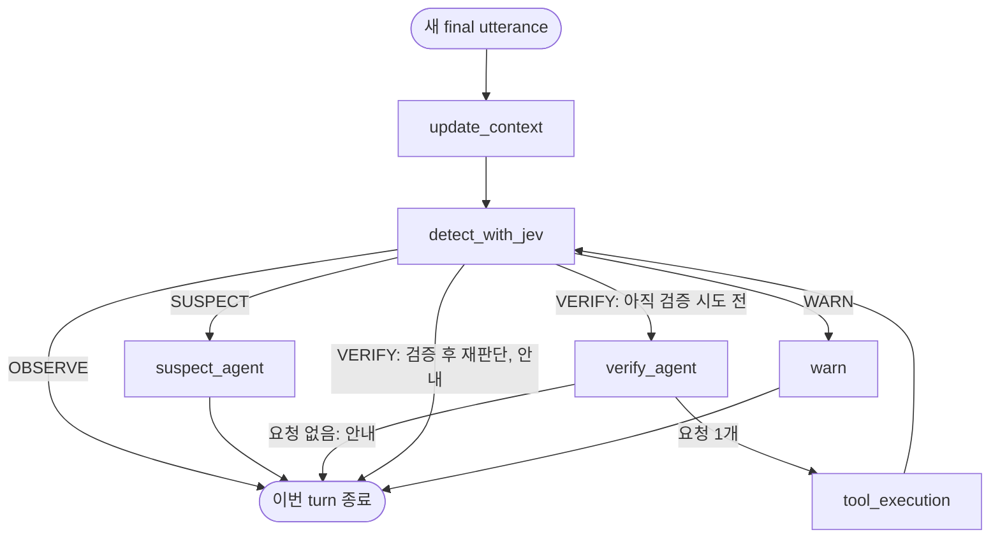

# ScamShield MVP 전체 스펙

상태: **데모 구현·API 없는 검사·실제 Gemini 세 발화 실행 완료**. 2026-10-11 사용자가 기존 설계 문서를 전체 스펙으로 확장하고 싶다고 요청했다. 2026-10-12 이슈 #1에 따라 CLI·State·Graph·Fake Jev·Mock 조회·역할별 Gemini 연결을 구현하고 검증했다. 기존 결정은 유지하고 외부 Jev API·실제 기관 조회처럼 확인이 필요한 항목은 미정으로 표시한다. 실제 결과는 [작업 기록](../../openspec/changes/first-demo/work.md)에 있다.

## 문서의 역할과 범위

이 문서는 **ScamShield MVP를 구현할 때 사용하는 통합 스펙**이다. 공통 State·Graph 규칙과 Jev·Agent·Tool의 역할/입출력/동작, 입력·응답 경계, 첫 데모의 검증 기준을 한 문서에서 관리한다. 별도 구성요소 설계 문서를 반드시 만들 필요는 없다. 통합 MVP 스펙은 외부 연결이 미정인 **초안**이며, 사용자 요청에 따라 이슈 #1의 데모 범위에 해당하는 내부 계약을 구현 기준으로 적용했다. 실제 외부 서비스의 확인된 계약과 구분한다.

| 영역 | 이 문서에 담는 내용 |
|---|---|
| 목적·범위 | 첫 통화 데모, MVP 기능과 제외 범위 |
| 공통 실행 | State 소유권·초기화·누적, Node·Edge, 전이·검증 한도 |
| 구성요소 | Jev·Suspect·Verify·Tool의 내부 계약과 행동 지침 |
| 입력·응답 | turn 입력, 정상/오류 결과, 사용자 안내 |
| 통화 유지 | callId별 순차 처리, checkpoint, timeout·실패 뒤 다음 입력 |
| 검증·미정 사항 | 시나리오별 인수조건, 외부 연결 전 확인할 계약 |

2026-10-12 리뷰 반영: 첫 완료 범위는 CLI에서 정해진 세 발화를 실행하고 State·Agent·Tool Calling·검증 후 재판단을 보여주는 것이다. 실패 뒤 통화 복구·동시 입력 제어·timeout 취소/늦은 완료 검사·실제 외부 연결은 후속 범위로 옮겼다. 필요한 세부 선택은 사용자 위임에 따라 에이전트가 진행했다.

첫 완료 목표는 한 통화에서 기관 사칭 대화 → 의심 안내 → 사건번호 Mock 조회 → 결과를 반영한 Jev 재판단 → WARN이 동작하는 것이다. 전체 한국어 대화·두 Agent·Tool Calling·State 유지가 MVP 중심이다. 현재 구현은 역할별 LLM 호출 방식이며 후속 Agent 런타임 전환과 구분한다.

Conversation DB·MQ·Redis·Microservice, 대화 요약·메모리 압축, Supervisor/번역/정보 추출 LLM, 여러 Tool 병렬 실행, 서버 재시작 복구는 MVP에 추가하지 않는다. 실제 STT·프론트 연결과 공공기관 조회는 외부 연결 계약 확인 뒤 진행한다.

현재 Python 의존성 설정과 [데모 코드](../../scamshield/graph.py)·테스트가 있다. 기존 [first-demo](../../openspec/changes/first-demo/work.md)에서 구현과 검증을 이어 기록한다. API 없는 실행 성공과 실제 Gemini 호출 성공은 구분한다.

## 실행 모델

- LangChain + LangGraph를 사용하며 새 final utterance 하나가 turn 하나를 시작한다. 입력 없는 background 실행은 없다.
- 같은 통화는 thread_id=callId와 같은 InMemorySaver 인스턴스를 사용한다. 새 통화에는 고유 callId를 사용한다.
- 전체 한국어 transcript와 통화 전체 verification_results를 보존한다. 요약·Sliding Window·별도 Conversation DB·evidence store는 두지 않는다.
- Jev가 risk·phase를 판단한다. Suspect와 Verify의 두 Agent, 고정 warn Node를 사용한다. Supervisor·번역·정보 추출 LLM은 추가하지 않는다.
- verify_agent와 tool_execution은 별도 부모 Graph Node다. Agent는 선택, 실행 Node는 실행과 결과 저장을 맡는다.
- 한 turn에서 실제 Tool 실행은 최대 1회, 결과 저장 후 Jev 재판단은 1회다. 자동 재시도는 없다.
- 데모 입력은 final utterance가 중복 없이 한 번씩 전달된다는 전제다. partial STT·동일 요청 재전송·발화 ID 기반 중복 제거는 이번 범위 밖이다. 실제로 반복해서 말한 동일 문장은 각각 새 발화다.

## State 책임과 내부 형식

다음은 [TypedDict/Pydantic으로 구현한 공통 필드 계약](../../scamshield/state.py)이다. callId는 실행 식별자로 받아 thread 설정에 전달하고 State에 중복 저장하지 않는다. 모든 channel은 기본 교체를 사용한다.

| 필드 | 초기값·의미 | 수정 책임 |
|---|---|---|
| utterance: str 또는 None | 이번 새 발화, update_context가 소비하면 None | 입력 경계·update_context |
| transcript: list[str] | 첫 통화 [], 통화 전체 발화 | update_context가 기존 목록 + [새 발화] 전체 목록으로 교체 |
| phase | 첫 통화 OBSERVE, 이후 최신 유효 판단 | 첫 초기화는 update_context, 이후 detect_with_jev |
| risk: float 또는 None | 첫 통화 None. 최초 성공 판단 전 미평가이며 0으로 대신하지 않음 | detect_with_jev |
| verification_results: list[VerificationResult] | 첫 통화 [], 통화 전체 검증 결과 | 첫 초기화는 update_context, 이후 tool_execution이 기존 목록 + [새 결과]로 교체 |
| response: str 또는 None | 새 turn마다 None, 이번 사용자 안내 | update_context·suspect_agent·warn 및 VERIFY 종료를 결정한 기존 Node |
| tool_request: dict 또는 None | ToolRequest 모델로 검증한 {tool,input} dict. 새 turn마다 None, 선택됐지만 아직 소비하지 않은 요청 | update_context·verify_agent·tool_execution |
| verification_attempted: bool | 새 turn마다 false. 이번 turn에서 Tool 실행을 시도하고 결과를 저장했는지 | update_context·tool_execution |

새 turn에서 phase·risk·대화·검증 결과를 초기값으로 덮어쓰지 않는다. response·tool_request·verification_attempted는 turn 실행 값이므로 매번 초기화한다. Tool 오류/timeout 결과를 저장한 경우도 verification_attempted=true다. Jev 재판단에서는 초기화를 반복하지 않는다.

미평가 risk는 None이다. 데모의 판단 후 risk는 유한한 0~1 숫자이고 VERIFY에는 risk >= 0.6을 요구한다. 이 값은 Fake Jev의 데모 계약이며 실제 Jev의 척도·판정 기준을 확정하는 값이 아니다. signals는 MVP State에 저장하지 않는다. 별도 previous_phase·phase 이력·messages·Tool 실행 counter는 추가하지 않는다.

### ToolRequest

공통 형식은 {tool: Tool 이름, input: 구조화 인자 object}다. verify_agent는 등록된 Tool의 schema로 검증한 요청 하나 또는 None을 반환한다. Tool별 인자 이름·타입은 이 문서의 Verification Tool 스펙을 따른다. Agent의 원시 Tool Calling 메시지는 이번 Agent 호출 안에서 처리하고 부모 State에는 이 요청만 저장한다.

요청은 State·checkpoint에 보관한다. tool_execution은 선택된 요청을 읽고 결과 목록·tool_request=None·verification_attempted=true를 한 Node 업데이트로 반환한다. 새 turn의 초기화에서도 이전 요청을 비워 오래된 요청이 실행되지 않게 한다.

이 형식을 선택한 이유는 분리된 두 Node의 연결을 checkpoint에서 확인할 수 있고, Agent 라이브러리의 내부 메시지 형식을 부모 State에 퍼뜨리지 않기 때문이다. verification_attempted는 기존 detect_with_jev Node가 최초 판단과 재판단을 구분하도록 하는 단순 boolean이다. 새 재판단 Node나 반복 counter를 만들지 않는다.

### VerificationResult

| 필드 | 의미 |
|---|---|
| tool | 실행한 Tool 이름 |
| input | 조회에 사용한 구조화 인자 |
| status | 실행 상태 OK / ERROR / TIMEOUT |
| result | 조회 내용 또는 실패 상세. JSON으로 표현 가능한 값 |
| is_mock | Mock 데이터 여부(boolean) |

OK는 정상 실행이며 안전 판정이 아니다. 정상 조회의 NOT_FOUND는 result에 저장한다. ERROR/TIMEOUT은 검증하지 못함이며 사기·안전·WARN을 강제하지 않는다. Mock 여부는 실행할 Tool의 설정에서 정하고 Agent가 임의로 지정하지 않는다. Mock 미등록과 실제 기관 미등록을 구분한다.

현재 Tool 실행 예외와 결과 schema 위반은 실행 Node에서 ERROR 결과로 정규화한다. TIMEOUT은 공통 타입과 Fake Jev의 결과 해석에 남겨둔 후속 계약이며 현재 Graph에 시간 초과 감지/취소 wrapper는 없다. 실패 상세는 {code, message} object를 사용하며 세부 오류 code와 도구별 정상 result는 Tool 스펙이 정한다. 내부 예외 객체를 result에 직접 저장하지 않는다. 정상·실패 모두 기존 결과 + [새 결과]의 전체 목록을 저장하며 append reducer를 함께 사용하지 않는다. Jev 재판단에서 같은 결과를 다시 추가하지 않는다.

## Node와 실행 순서

| Node | 주요 읽기 | 주요 쓰기·동작 | 다음 실행 |
|---|---|---|---|
| update_context | 이번 utterance·복원된 State | 첫 통화 기본값, 새 대화 추가, utterance 소비, turn 실행 값 초기화 | detect_with_jev |
| detect_with_jev | 전체 transcript·호출 직전 phase·누적 검증 결과 | Jev 출력 검증 후 risk·phase 적용. verification_attempted로 재판단 구분 | phase에 따른 분기 |
| suspect_agent | 전체 대화·현재 State | 외부 Tool 없이 이번 확인 행동 response 생성 | END |
| verify_agent | 전체 대화·현재 State·사용 가능한 Tools | 유효한 요청 하나 또는 None, 요청 없음이면 종료 안내 | 요청 있으면 tool_execution, 없으면 END |
| tool_execution | tool_request·기존 결과·Tool 설정 | 최대 1회 실행, 정상/실패 결과 저장, 요청 소비·시도 표시 | detect_with_jev |
| warn | 고정 문구 | 경고 response | END |

Conditional Edge는 적용된 phase와 verification_attempted를 읽어 경로만 선택한다. 새 위험 판단이나 결과 해석을 맡지 않는다. detect_with_jev는 외부 판단을 검증한 뒤 적용하고 Tool 요청은 verify_agent가 검증한다. 검증 오류는 정상 routing으로 보내지 않는다.

한 번의 실행 경로는 update_context → 최초 Jev → phase별 처리다. VERIFY이면 선택 → Tool 결과 저장 → 같은 detect_with_jev의 재판단으로 이어진다. 재판단 뒤 VERIFY는 종료하고, OBSERVE/SUSPECT/WARN은 각 종료 경로를 따른다. 이 Graph 구조와 verification_attempted 검사로 같은 turn의 두 번째 Tool 실행을 막는다. Tool 실행 Node도 이미 true인 요청을 실행하지 않고 실행 계약 오류로 중단한다.

## Phase 전이와 검증 책임

기존 WARN 고정·유연한 진입/하향 방향에 맞춰 나머지 전이도 다음 범위로 정리했다. 허용은 Jev가 해당 phase를 반환할 수 있다는 뜻이며 코드가 상태를 강제로 올리거나 내린다는 뜻이 아니다.

| 이전 phase | OBSERVE | SUSPECT | VERIFY | WARN |
|---|---|---|---|---|
| OBSERVE | 허용 | 허용 | 조건부 허용 | 허용 |
| SUSPECT | 허용 | 허용 | 조건부 허용 | 허용 |
| VERIFY | 허용 | 허용 | 조건부 유지 | 허용 |
| WARN | 금지 | 금지 | 금지 | 유지 |

VERIFY에는 검증 가능한 정보·검증 필요성·충분한 의심이 요구된다. OBSERVE에서 바로 VERIFY로 갈 수 있으며 이전 SUSPECT 이력은 필수가 아니다. 새 위험 정보나 정상 검증으로 OBSERVE/SUSPECT까지 하향할 수 있으나 같은 통화의 WARN 하향은 허용하지 않는다. VERIFY 유지 허용과 같은 turn에서 추가 Tool 실행 금지는 별개다.

데모에서 detect_with_jev는 유한 risk·0~1 범위·phase enum·전이표와 VERIFY risk >= 0.6을 검사한다. 실제 Jev의 기준은 향후 실제 연동에서 확인한다. 검증 가능한 정보와 필요성을 판단하는 책임은 Jev·Verify의 상세 계약에 둔다. 정책 위반 시 출력을 적용하지 않고 오류 반환하며 자동 phase 보정은 하지 않는다. 최초 판단과 재판단 모두 같은 검증 원칙을 적용한다.

## 종료·출력·실패

### 정상 종료

| 종료 상황 | 이번 response·처리 |
|---|---|
| OBSERVE | None, 사용자 행동 안내 없음 |
| SUSPECT | suspect_agent의 확인 행동 안내 |
| WARN | 고정 경고 문구 |
| VERIFY에서 유효한 선택 결과가 요청 없음 | verify_agent가 고정 안내를 저장하고 END. Tool·재판단 없음 |
| 결과 저장 후 Jev가 다시 VERIFY | detect_with_jev가 고정 안내를 저장하고 END. 추가 Tool 없음 |

요청 없음 안내의 기본 문구는 “현재 정보로는 조회할 대상을 정하기 어렵습니다. 상대방에게 기관명과 확인 가능한 정보를 요청하세요.”다. 재판단이 VERIFY인 종료 안내는 “확인한 결과만으로는 판단하기 어렵습니다. 상대방의 주장을 추가로 확인하고, 확인 전 송금이나 개인정보 제공을 보류하세요.”다. 문구 개선은 Agent/응답 스펙에서 할 수 있으나 종료와 response 작성 책임은 유지한다.

WARN 기본 문구는 “현재 통화는 보이스피싱일 가능성이 매우 높습니다. 송금, 개인정보 제공, 앱 설치를 중단하고 통화를 종료하세요.”다. Tool 결과만으로 WARN을 강제하지 않고 Jev 판단을 따른다.

내부 정상 결과는 {callId, risk, phase, response, verification_results}다. 정상 완료에는 유효한 Jev 판단이 있어야 하므로 risk는 숫자다. transcript·tool_request·실행 flag는 외부 정상 결과에 포함하지 않는다. 실제 HTTP/WebSocket envelope와 중간 risk 전송은 입력/응답 연결 스펙에서 정한다.

### 실행 오류

- 입력 경계에서 비어 있는 callId·utterance나 잘못된 타입을 거부하고 State를 수정하지 않는다. transcript에는 검증한 발화 원문을 보존한다.
- Jev·Agent 호출 실패/출력 검증 실패는 자동 재시도 없이 이번 실행 오류다. 이전 phase를 새 성공 판단으로 반환하지 않는다.
- Gemini 호출 실패의 message에는 SDK 예외 원인에서 HTTP 코드·상태와 API 오류 요약을 제공한다. 키는 마스킹하며 요청/headers/상세 오류 전체는 출력하지 않는다. 알 수 없는 로컬 예외는 타입명만 제공한다. 이는 CLI 진단이며 인증 성공의 근거가 아니다.
- Verify의 요청 없음은 유효한 선택 결과다. 알 수 없는 Tool·잘못된 인자·여러 요청은 Agent 출력 검증 실패이며 어느 Tool도 실행하지 않는다. 임의로 첫 요청을 선택하지 않는다.
- Tool 실행 예외·출력 오류는 ERROR 결과로 저장하고 Jev 재판단한다. TIMEOUT 결과 생성과 취소는 후속 외부 Tool 연결 범위다. 재판단 Jev가 실패하면 실행 오류를 반환한다.
- checkpoint/State 저장·Graph 내부 계약 실패는 실행 오류다. 저장에 실패한 결과를 정상 처리 완료로 반환하지 않는다.

내부 오류 결과는 {callId, error: {stage, code, message}}다. 현재 stage는 input/jev/suspect_agent/verify_agent/tool_execution/runtime을 사용한다. 별도 DemoError로 분류하지 못한 Graph/checkpoint 오류는 runtime/CALL_FAILED로 반환한다. checkpoint 전용 stage/code는 후속 오류 분류 후보다. 정상 결과와 오류 결과는 구분하며 error는 State의 사용자 안내 response에 넣지 않는다. 상세 오류 code·외부 API 전달 형식은 각 연결 스펙에서 맞춘다.

### 실행 오류 뒤 시나리오 재시작

Jev·Agent·Graph 실행 오류를 반환하면 CLI는 해당 통화 시나리오를 중단한다. 재시작은 새 callId로 세 발화를 처음부터 실행한다. 실패한 callId의 중간 checkpoint에서 재개하거나 다음 발화를 이어 처리하지 않는다. 기존 State/checkpoint는 관찰용으로 남기고 rollback·삭제·복구 로직은 추가하지 않는다. Tool 실행 실패를 결과로 변환해 Jev가 재판단하는 기존 정책은 유지하며 재판단까지 실패하면 시나리오를 중단한다.

## 데모 실행·checkpoint

[CLI](../../scamshield/cli.py)가 세 final utterance를 한 번씩 순차 전달하고 각 Graph 실행 완료를 기다린다. 새 시나리오 실행마다 고유 callId를 생성한다. 각 Node의 이름·실행 순서, phase/risk, Tool 요청·결과, response를 터미널에 출력해 역할 분리와 검증 결과 반영을 보여준다. 실행 명령은 [README](../../README.md)에 있다. 기본은 입력 대기, `--auto`는 준비된 세 발화 자동 입력, `--offline`은 명시적인 Agent 대역 실행이다.

세 발화는 state.py의 DEMO_UTTERANCES에 하드코딩되어 있고 상대방 역할의 AI는 없다. 직접 입력에서도 CLI는 세 번 입력 후 종료한다. 이 횟수 제한은 CLI의 데모 시나리오이며 CallDemo/Graph는 같은 정상 callId로 추가 turn을 처리할 수 있다. 현재 입력·transcript에는 화자 정보가 없다. 실제 양쪽 화자 STT 요구는 아래 후속 입력 계약에서 다룬다.

첫 데모의 case_lookup은 즉시 반환하는 Mock 함수다. 요청 직렬화 lock·STT 수신 큐·전체 turn 대기 한도·Tool timeout 실행 wrapper와 취소/늦은 완료 검증은 첫 완료 조건에서 제외한다. 실제 외부 Tool이나 동시 STT 입력을 연결할 때 같은 통화 순차 처리와 설정 가능한 timeout(후속 기본값 후보 5초)을 적용한다. ERROR/TIMEOUT 결과의 공통 형식은 유지한다.

같은 callId는 동일 InMemorySaver와 thread_id를 사용하고 sync로 checkpoint를 저장한다. 통화 종료·시나리오 중단 후에도 프로세스 생존 동안 유지한다. 재시작 복구·cleanup·여러 프로세스 공유·실시간 늦은 결과 반영은 후속 범위다. 첫 데모의 순서는 호출자가 기다리는 CLI 흐름으로 보장하며 Checkpointer의 자동 직렬화를 가정하지 않는다.

## 결정 이력의 연결

다음 항목은 기존 Q1~Q14를 찾기 위한 진입점이다. 현재 실행 규칙의 기준은 위 본문이며 최초 선택·비교·검증의 시간순 근거는 [work](../../openspec/changes/first-demo/work.md)에 보존한다. 사용자가 핵심 정책을 선택했고, 남은 공통 실행 세부는 에이전트의 선택을 허용한 후속 요청에 따라 본문에 보완했다.

### Q1. 새 STT 입력을 어떻게 전달하고 Transcript에 merge할까?

utterance 입력 channel, 기존 대화 + [새 발화] 전체 목록 기본 교체, 소비 후 None. 입력 재사용 없이 갱신된 전체 대화를 Jev·Agent가 읽는다.

### Q2. verification_results는 전체 누적일까, 최근 검증 batch일까?

통화 전체 누적, 공통 5개 필드, OK/ERROR/TIMEOUT, 기존 결과 + [새 결과] 전체 목록 기본 교체. 도구별 결과·재조회/상충 해석은 Tool 스펙의 역할이다.

### Q3. 어떤 phase transition을 허용할까?

WARN 하향 금지, 나머지는 Jev 판단에 따른 유연한 전이. VERIFY 의미 조건과 데모 risk >= 0.6을 적용한다. 실제 Jev 기준은 후속 연동에서 정한다.

### Q4. 한 utterance에서 검증과 재판단을 몇 번 할까?

Tool 최대 1회·결과 저장 후 Jev 재판단 1회. 검증 시도 boolean과 Graph routing으로 재진입을 막고 VERIFY 종료 안내를 반환한다.

### Q5. 같은 callId의 STT 실행이 겹치면 어떻게 할까?

첫 데모는 CLI가 turn 완료를 기다린 뒤 다음 발화를 전달한다. 동시 요청·timeout 실행·늦은 결과 처리는 후속 연결 범위다.

### Q6. 무엇을 새 utterance로 보고 중복 append를 막을까?

final utterance의 중복 없는 데모 전제. 실제 재전송·발화 ID 계약은 연결 스펙의 역할이다.

### Q7. Tool 실행은 부모 Graph Node일까, Verify Agent 내부일까?

독립 verify_agent와 tool_execution Node, State의 tool_request로 전달·checkpoint 저장·소비 후 None. 요청 없음은 안내 후 종료, 여러/잘못된 요청은 실행 오류다.

### Q8. Jev 결과를 코드에서 검증하고 불허 전이를 막을까?

detect_with_jev에서 schema·유한 risk·허용 전이·Jev 스펙의 수치 조건을 검증한 뒤 적용. 실제 Jev 계약은 후속 스펙에서 정한다.

### Q9. signals를 ScamState에 포함할까?

MVP State에서 제외. 실제 Jev 선택 출력과 State 저장 여부를 구분한다.

### Q10. 사용자 안내 response를 State에 보관할까?

State·checkpoint에 최신 turn 안내 저장, 새 turn에 None. 정상·VERIFY 종료의 작성 책임은 종료 표를 따른다.

### Q11. Jev·Agent·Tool이 실패하면 이 turn과 다음 입력은 어떻게 처리할까?

Jev·Agent 실패는 자동 재시도 없는 실행 오류. Tool 실패는 결과 저장 후 재판단. 데모 실행 오류는 해당 시나리오를 중단하고 새 callId로 처음부터 재시작한다. 같은 통화의 실패 뒤 계속 처리는 후속 범위다.

### Q12. 첫 통화의 phase·risk·목록 초기값은 무엇일까?

OBSERVE, risk=None, 빈 대화·검증 결과, response/tool_request=None, verification_attempted=false. 기존 통화의 누적 도메인 상태는 초기화하지 않는다.

### Q13. InMemorySaver를 어떤 durability로 사용할까?

sync checkpoint 저장. 동일 통화의 상태 유지·새 callId의 분리를 데모 검사에서 확인한다.

### Q14. 종료된 통화의 State는 언제 삭제할까?

통화 종료 후에도 프로세스 생존 동안 유지, 통화마다 고유 callId. 운영 cleanup은 후속 범위다.

## Jev 스펙

역할은 전체 통화를 읽고 현재 risk·phase를 결정하는 것이다. 최초 판단과 Tool 결과 반영 후 재판단은 같은 내부 계약을 사용한다.

| 구분 | 내부 계약 |
|---|---|
| 입력 | transcript: 전체 list[str], previous_phase: 호출 직전 phase, verification_results: 누적 목록(없으면 []) |
| 출력 | risk: 유한한 0~1 숫자(데모), phase: OBSERVE/SUSPECT/VERIFY/WARN |
| 선택 출력 | signals는 외부 모델이 제공할 수 있으나 MVP State·routing에서 사용하지 않음 |
| 적용 | detect_with_jev가 형식·전이·확정된 risk 조건을 검사한 뒤 risk와 phase를 함께 반영 |
| 실패 | 호출/출력 검증 오류를 반환, 자동 재시도·phase 보정 없음 |

판단 지침은 개별 번호의 등장보다 대화 맥락·상대의 요구·확인 필요성을 함께 보고, VERIFIED/NOT_FOUND 같은 Tool 내용과 실행 오류를 구분하는 것이다. VERIFY는 충분한 의심과 검증 가능한 대상이 있을 때 선택한다. 정상 조회만으로 OBSERVE를 강제하거나 Mock 미등록·timeout만으로 WARN을 강제하지 않는다. WARN 하향은 허용하지 않는다.

실제 Jev의 endpoint·인증·요청/응답 포맷, risk 척도/허용 범위·threshold는 **첫 데모 이후 확인할 외부 계약**이다. 위 입력 이름은 내부 계약이며 외부 API 필드라고 주장하지 않는다. 연동 시 확인된 계약을 내부 계약으로 변환한다.

### Fake Jev의 데모 판단 규칙

Fake는 호출 횟수가 아니라 **누적 transcript·이전 phase·누적 결과**를 읽어 다음 규칙을 적용한다. 데모 risk는 OBSERVE=0.1, SUSPECT=0.5, VERIFY=0.7, WARN=0.9이며 실제 탐지 모델을 보정한 값이 아니다.

| 입력과 결과 조건 | 출력 |
|---|---|
| #1 “안녕하세요. 서울중앙지검입니다.” | OBSERVE, 0.1 |
| #1+#2 “고객님 계좌가 범죄에 연루되었습니다.” | SUSPECT, 0.5 |
| #1+#2+#3 “사건번호는 2026-12345입니다.”, 해당 번호의 검증 결과 없음 | VERIFY, 0.7 |
| 동일 세 발화 + 해당 번호의 case_lookup 정상 Mock NOT_FOUND 결과 | WARN, 0.9 |
| 동일 세 발화 + ERROR/TIMEOUT 등 검증하지 못한 결과 | VERIFY, 0.7, 재판단 후 추가 검증 없이 종료 |
| 동일 세 발화 + 정상 FOUND 결과 | SUSPECT, 0.5, 확인 안내 후 종료 |
| 이전 phase=WARN | WARN, 0.9 유지 |

이전 WARN 유지가 우선이다. 나머지는 누적 대화에 서울중앙지검 주장과 계좌/범죄 연루 발화가 있고 2026-12345가 제시됐는지 검사한다. 기관 주장만 있거나 이 정해진 의심 조건이 없으면 OBSERVE, 의심 발화까지 있고 해당 사건번호가 아직 없으면 SUSPECT다. 위 내용은 정해진 데모 문구를 위한 단순 규칙이며 일반적인 사기 탐지가 아니다.

현재 코드는 대화에 `서울중앙지검` 문자열이 포함됐는지, 한 발화에 `계좌`/`범죄`/`연루`가 함께 포함됐는지, 대화에 `2026-12345`가 포함됐는지를 검사한다. Mock의 FOUND 번호 `2026-00001`만 제시하는 것으로는 VERIFY에 진입하지 않는다. 위험 판단과 검증 진입은 Fake Jev가 맡으며 Gemini의 역할은 진입 후 문맥에서 조회 대상/도구를 선택하는 것이다.

검증 결과는 tool=case_lookup·input.case_number=2026-12345인 최신 결과를 사용한다. WARN 조건의 정상 결과는 status=OK·is_mock=true·result.lookup_status=NOT_FOUND다. FOUND도 정상 Mock 결과로만 데모 분기를 확인한다. 다른 번호의 결과나 실패 결과로 WARN을 반환하지 않는다. WARN은 **정해진 기관 사칭/범죄 연루 대화와 해당 번호의 Mock 조회 결과를 함께** 반영한 데모 규칙이다. Mock 미등록 하나만으로 실제 기관의 사건 미등록이나 실제 통화의 사기를 판정하지 않는다.

## Agent 스펙

### Suspect Agent

입력은 전체 transcript와 현재 State다. 출력은 비어 있지 않은 한국어 안내 문자열이며 response에 저장한다. 외부 Tool·risk/phase 수정·별도 memory는 없다.

행동 지침은 이번 대화에 필요한 확인 행동을 1~2문장으로 안내하는 것이다. 상대가 주장한 기관명·사건번호·연락처 등을 확인하도록 안내하며 확인하지 않은 사실이나 조회 결과를 만들어내지 않는다. 역할은 위험 판정 대신 확인 행동 생성이다. 예시: “상대방에게 정확한 기관명과 사건번호를 물어보세요. 안내받은 정보는 기관의 공식 연락처로 확인하세요.”

### Verify Agent

입력은 전체 transcript·현재 State·누적 검증 결과·등록된 Tool 설명과 인자 schema다. 출력은 유효한 ToolRequest 하나 또는 None이다. 대화에 없는 인자를 만들어내지 않고 검증 목적에 맞는 도구를 선택한다. 충분한 인자가 없으면 None을 반환한다.

Verify는 같은 모델을 한 번 호출하고 LangChain의 Tool Calling 출력에서 tool_calls 0개를 None, 1개를 검증한 {tool,input}, 여러 개를 기존 출력 오류로 변환한다. 이 선택 단계에서 Tool을 자동 실행하는 Agent loop는 사용하지 않는다. 원시 메시지는 이번 호출 안에서 처리하며 부모 Graph의 tool_execution이 실제 실행을 맡는다. 여러 요청·알 수 없는 도구·잘못된 인자는 출력 검증 실패다. 모델이 None을 선택한 경우는 정상 종료 안내 경로다.

기존 동일 대상 결과는 참고하되 MVP에서 자동 cache·재조회 차단은 추가하지 않는다. 새 turn에 실제로 같은 Tool 요청을 선택하면 다시 실행하고 결과를 별도 누적한다. 상충 결과는 이전 것을 지우지 않고 Jev가 전체 목록과 Mock 여부를 보고 재판단한다.

### 첫 Agent 모델·호출 방식

무료 실험을 원하는 사용자 방향에 따라 기본 Provider는 Gemini Developer API, 모델은 gemini-3.8-flash로 선택했다. 두 Agent는 같은 모델/연결을 사용하며 역할 prompt와 Tool 권한만 나눈다. Suspect는 Tool 없이 1회 생성, Verify는 case_lookup schema를 제공한 Tool Calling 1회다. 자동 Tool 실행과 모델 재호출 loop는 추가하지 않는다.

2026-10-12 공식 [Gemini 요금](https://ai.google.dev/gemini-api/docs/pricing)과 [Function Calling](https://ai.google.dev/gemini-api/docs/function-calling) 문서를 확인했다. [Gemini 연결](../../scamshield/gemini.py)은 `langchain-google-genai`의 ChatGoogleGenerativeAI를 사용한다. `GEMINI_MODEL`로 모델을 변경하고 `GEMINI_API_KEY`로 키를 제공한다. Developer API를 명시하고 자동 재시도는 비활성화한다. Suspect에는 Tool을 제공하지 않고 Verify에는 case_lookup 선언만 bind하며 결과를 모델에 재전송하지 않는다. Gemini가 무시하는 additionalProperties는 선언에서 제외하고 로컬 계약에서 추가 인자를 거부한다. [LangChain 공식 연결 안내](https://docs.langchain.com/oss/python/integrations/chat/google_generative_ai)를 확인하고 설치 SDK의 요청 생성·응답 변환을 전송 대역으로 검증했다. 이후 로컬 키로 실제 안내/Tool Calling·세 발화 최종 WARN을 확인했다. 실제 조회 데이터와 대화는 데모용이다. 계정의 무료 한도는 [AI Studio의 한도 안내](https://ai.google.dev/gemini-api/docs/rate-limits)와 별도 사용 현황으로 확인해야 한다.

실제 재검증 중 Verify 호출이 HTTP 504 DEADLINE_EXCEEDED로 실패한 사례를 관찰했다. 짧은 생성/선택에 맞춰 [공식 Thinking 안내](https://ai.google.dev/gemini-api/docs/thinking)를 확인하고 thinking_level=low, SDK 호출 timeout=120초로 조정한 뒤 최종 CLI 성공을 확인했다. 호출 1회·자동 재시도 없음은 유지한다. 이 검증은 Provider의 지속적인 응답 속도나 가용성 보장이 아니다.

GPT는 향후 비교 실험 후보이며 무료 API로 가정하지 않는다([OpenAI API 요금](https://developers.openai.com/api/docs/pricing)). 첫 데모에 두 Provider 지원·비교 UI를 구현하지 않는다. 계정에서 선택 모델을 사용할 수 없으면 사용 가능한 Function Calling 모델을 같은 설정 자리에서 교체한다. API 없는 Graph 검사는 Agent 대역, 실제 Tool Calling 확인은 Gemini 호출로 구분한다.

### TODO — 데모 이후 Agent 실행 구조로 전환

2026-10-12 사용자 요청: 지금은 역할별 prompt와 LLM API 1회 호출로 데모를 진행하되, 후속 단계에서는 Suspect/Verify를 Agent 실행 객체·런타임으로 구현하고 Graph Node가 해당 Agent를 호출하는 구조로 전환한다. 현재 문서의 Agent 이름은 논리적 역할이며 Agent 런타임 구현이 완료됐다는 뜻이 아니다.

- [ ] Suspect·Verify의 역할별 Agent 실행 인터페이스와 사용할 프레임워크 구성을 정한다.
- [ ] Node의 직접 모델 호출·출력 처리 코드를 Agent 실행 호출로 전환하고 두 역할의 입출력·권한을 연결한다.
- [ ] Agent 실행 안에서 판단·Tool 선택·결과 활용을 어디까지 맡길지 정하고, 현재 부모 Graph의 Tool 실행·Jev 재판단과 책임이 겹치지 않게 맞춘다.
- [ ] Agent 전환 뒤 기존 데모 시나리오·State 유지·Tool 결과 반영을 검증한다.

이 TODO는 후속 작업이며 현재 데모의 1회 모델 호출·독립 tool_execution·Tool 최대 1회·Jev 재판단 1회 범위를 변경하지 않는다. Agent 전환에 반복 실행이나 Tool 실행 위치 변경이 필요하면 그 단계의 설계에서 정한다. 별도 모델 학습·Supervisor·독립 memory를 이번 요청만으로 추가하지 않는다.

## Verification Tool 스펙

첫 데모에서 실제 제공할 Tool은 **Mock case_lookup 하나**로 시작한다. phone_lookup/url_lookup/account_lookup은 추가 후보이며 이번 데모에 모두 구현해야 하는 목록은 아니다.

| case_lookup 항목 | 내부 스펙 초안 |
|---|---|
| 입력 | {case_number: 비어 있지 않은 문자열} |
| 정상 result | {lookup_status: FOUND 또는 NOT_FOUND, reason: 결과 설명 문자열} |
| Mock fixture | 2026-00001과 정확히 일치할 때만 FOUND, 나머지는 모두 NOT_FOUND. 2026-12345는 데모의 NOT_FOUND 예시 |
| 조회 범위 | Mock 테이블의 정확한 사건번호 일치. 실제 기관의 사건 존재 여부를 확인하는 기능은 아님 |
| 저장 | 원래 조회 인자·정상 내용, status=OK, is_mock=true를 공통 VerificationResult로 감쌈 |
| 실행 실패 | 현재 result={code,message}, status=ERROR. TIMEOUT 결과 생성은 후속 범위 |

case_number를 원문에서 선택하되 기관별 사건번호 정규식이나 실재성을 임의로 가정하지 않는다. 입력 타입/공백 여부는 검증하고 인자 변조·추측으로 조회하지 않는다. Agent가 과거 결과를 참조하더라도 이번 요청의 원래 인자를 저장한다.

첫 데모의 요청 검증은 대화에서 하이픈으로 연결된 숫자열 전체를 찾아 case_number와 정확히 비교한다. `2026-12345`의 일부인 `2026` 또는 `12345`는 INVALID_OUTPUT으로 거부하며 Tool 실행·결과 저장을 하지 않는다. 이 검사는 데모 인자의 잘림 방지이며 실제 기관의 사건번호 형식이나 존재 여부를 검증하는 규칙이 아니다.

현재 실패 code는 TOOL_EXECUTION_FAILED(호출 오류), TOOL_RESULT_INVALID(정상 결과 schema 위반)다. TOOL_TIMEOUT은 후속 시간 초과 구현 후보이며 현재 발생시키지 않는다. message는 실패 설명이며 내부 예외 객체는 저장하지 않는다. 첫 데모의 즉시 반환 Mock에는 timeout wrapper를 추가하지 않는다. 실제 외부 Tool의 timeout 적용은 후속 범위다. 실제 공공기관 조회 데이터·API·기관별 인자 형식은 **외부 연결 미정**이다.

이 Tool별 object result는 기존 공통 result 필드를 구체화한 내부 초안이다. 이전 NOT_FOUND 문자열 예시는 결과 의미를 설명한 것이며 실제 외부 조회의 확정 포맷이 아니다.

## 입력·응답 스펙

내부 turn 진입점은 {callId: 비어 있지 않은 문자열, utterance: 비어 있지 않은 final 발화 문자열}을 받는다. 공백만 있는 입력은 거부하며 유효한 발화 원문은 transcript에 보존한다. callId는 호출자가 통화마다 고유하게 생성하고 같은 통화에서 재사용한다. 내부 입력은 식별자와 발화만 받으며 호출자가 phase·risk·누적 검증 결과를 덮어쓰게 하지 않는다.

정상 결과는 위 종료 계약의 {callId,risk,phase,response,verification_results}다. 검증하지 않은 외부 정보가 확인된 것처럼 보이지 않도록 Mock 결과에는 is_mock=true를 유지한다. 실행 오류는 {callId,error:{stage,code,message}}이고 식별자부터 잘못된 입력의 callId는 None일 수 있다. 현재 오류 code는 INVALID_INPUT, CALL_FAILED, INVALID_OUTPUT, INVALID_TRANSITION, EXECUTION_CONTRACT_VIOLATION이며 CLI 설정 단계에는 MISSING_API_KEY도 사용한다. CHECKPOINT_FAILED는 후속 전용 분류 후보다. stage로 실패 위치를 구분하며 외부 API 상태 코드와 동일하다고 가정하지 않는다.

실제 통화에서는 상대방과 사용자 양쪽 발화를 STT로 받고 화자를 구분해 같은 callId의 대화에 누적한다는 사용자 요구가 있다. 현재 list[str] transcript에는 화자 정보가 없고 발화는 CLI 문자열 입력이다. 화자 정보가 포함된 입력/State schema, STT Provider·partial/final 변환·발화 재전송, HTTP/WebSocket route/envelope·중간 risk 이벤트, 수신 큐 운영 한도는 **후속 설계·외부 연결 미정**이다. 이를 현재 구현 완료로 표시하지 않는다.

## 첫 데모의 구현·검증 기준

| 확인할 동작 | 첫 완료 조건 |
|---|---|
| 세 발화 시나리오 | CLI에서 OBSERVE 0.1 → SUSPECT 0.5 → VERIFY 0.7 → 결과 저장 후 WARN 0.9 |
| 상태 유지·분리 | 같은 통화 transcript 3개·결과 1개 유지, 새 callId는 별도 상태 |
| 실제 역할별 모델 동작 | Suspect 안내 생성, Verify가 모델의 Tool Calling으로 case_lookup과 case_number=2026-12345 선택. Agent 실행 런타임과 구분 |
| 결과 반영 | status=OK·Mock NOT_FOUND를 저장한 뒤 같은 transcript와 결과로 Jev 재판단. 호출 순번으로 WARN을 고정하지 않음 |
| 실행 한도 | 해당 turn의 실제 Tool 1회·결과 후 재판단 1회, transcript/결과의 중복 추가 없음 |
| 관찰 가능한 출력 | Node 실행 순서·phase/risk·Tool 요청/결과·사용자 안내가 CLI에 표시됨 |

API 없는 Graph 검사는 Fake Jev·Mock case_lookup·Agent 대역으로 핵심 상태/흐름을 확인했다. 모델 응답 대역·설치 SDK의 전송 대역과 CLI 자동/순차 입력도 검증했다. 이어 실제 Gemini로 두 역할 호출·case_lookup의 정확한 사건번호 선택·최종 WARN을 확인해 첫 데모 인수조건을 충족했다. 실행한 검사와 결과는 [work](../../openspec/changes/first-demo/work.md)에 남긴다.

오류 fixture의 포괄적 검사, 실패 뒤 같은 통화 재개, timeout/취소/늦은 완료, 동시 STT 입력·수신 큐 검증은 첫 완료 조건에서 제외한다. 기본 형식 검증과 오류 반환은 유지하되 실패하면 새 callId로 재시작하는 데모 흐름으로 처리한다.

## 남은 준비와 후속 범위

데모 구현·API 없는 검사와 실제 Gemini 실행을 완료했다. 키는 로컬 환경변수 또는 uv의 명시적 `--env-file .env`로 제공하며 문서나 채팅에 적지 않는다. 현재 계정의 해당 모델 호출 성공을 확인했지만 무료 한도나 지속적인 호출 가능성을 보장하는 검증은 아니다.

실제 Jev API/인증/risk 보정·탐지 성능, 기관 조회/추가 Tool/정교한 상충 해석, STT·HTTP/WebSocket·프론트 연결, 통화 실패 복구·timeout 취소·운영 cleanup은 후속 작업이다. 데모 코드가 이 작업을 모두 지원할 필요는 없다. 늦은 Tool 결과를 활용하는 비동기 방식도 기존 Future Optimization으로 유지한다.

후속 STT 입력 계약은 양쪽 화자의 식별·발화 순서·통화별 누적을 포함해 구체화한다. 사용자 입력을 종료 명령까지 계속 받는 CLI 확장은 현재 구현하지 않았으며 세 번 입력 제한과 Graph의 상태 유지 능력을 구분한다.

## 관련 문서와 확인 근거

- [프로젝트 컨텍스트](../project-context.md) · [상세 설계 인덱스](index.md) · [아키텍처 인덱스](../architecture/index.md)
- [MVP 흐름 설계](mvp-flow.md) — 데모 시나리오와 Fake/Mock 검증 범위
- [기존 first-demo change](../../openspec/changes/first-demo/proposal.md) · [작업·검증 근거](../../openspec/changes/first-demo/work.md)
- [LangGraph Graph API](https://docs.langchain.com/oss/python/langgraph/graph-api) — schemas, reducers, runtime context, recursion limit
- [LangGraph Checkpointers](https://docs.langchain.com/oss/python/langgraph/checkpointers) — super-step, snapshot, durability
- [LangGraph Persistence](https://docs.langchain.com/oss/python/langgraph/persistence) — thread memory와 InMemorySaver의 RAM 보관

공식 문서 확인일: 2026-10-10. 저장소 lock의 LangGraph는 1.2.14, langgraph-checkpoint는 4.2.0이다. 위 근거는 Framework 동작 설명이며 프로젝트의 미정 정책을 승인하는 근거가 아니다.
