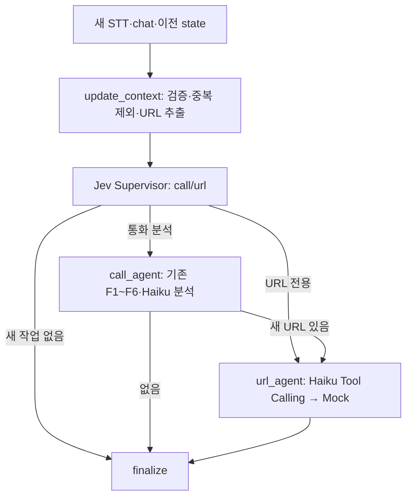

# Jev Supervisor·채팅·URL 계약

상태: 2026-11-23 사용자 요청대로 구현, PR 대상 전체 API 없는 테스트 124개 통과. 실제 모델·BE 연결은 후속이다. 검증과 한계는 [work](../../openspec/changes/jev-supervisor-url/work.md)에 기록한다. 기존 통화 분석은 [State·Graph](state-and-graph.md)를 유지한다.

## 입력과 실행

입구는 [SupervisorPipeline](../../scamshield/agents/supervisor.py)의 `analyze(history, new_lines, state, now, *, chat=None)`다. `build_supervisor_pipeline(offline=True)`는 명시적인 규칙 대역이다. live는 Jev Supervisor와 기존 Jev 감지·Haiku 분석, Haiku URL agent를 사용한다. URL 검색은 두 모드 모두 Mock이다.

| 입력 | 계약 |
|---|---|
| `history` | 이전 통화 분석에 전달한 전체 줄. 서버 보관. Supervisor 라우팅에는 보내지 않는다. |
| `new_lines` | 이번 새 STT `{seq, text}`. 채팅 전용 호출이면 빈 목록 가능. STT 재전송 제거는 서버 책임. |
| `chat` | `{id: str, seq: int, text: str}` 목록. 새 메시지만 보내는 것을 권장하지만 이전 채팅을 포함해도 완료한 ID는 제외한다. |
| `state` | 이전 Supervisor 응답의 state. 새 통화면 `None`. 기존 통화 state를 이전하려면 `{"call_state": old_state}`로 감싼다. |
| `now` | 유한한 초 단위 시각. 통화 점수 시간 계산에 사용한다. |

`seq`는 STT·채팅을 통틀어 서버가 발급하는 순서/근거 번호다. 이번에 통화 분석에 전달할 줄끼리 중복되면 오류다. ID는 통화 안에서 불변이며 텍스트·seq가 바뀌면 새 ID를 쓴다. 같은 ID가 다른 내용으로 오면 오류다.

Supervisor는 처리하지 않은 STT·채팅과 `pending_urls`만 보고 call/url을 독립적으로 고른다. STT나 URL 없는 새 채팅은 call이 필수이고, 조회할 새 URL이 있으면 url이 필수다. 모델이 이를 누락하면 오류로 올려 입력을 조용히 소비하지 않는다. URL과 송금 요구 등이 함께 있는 채팅은 두 경로로 갈 수 있다. URL 전용 채팅은 통화 경로 없이 조회할 수 있다. 둘 다 필요하면 통화→URL 순서로 실행하므로 URL 경로 선택이 STT를 밀어내지 않는다.

## 응답과 상태

구조를 내보낼 때 `python -m scamshield.export_graph --supervisor`는 실제 컴파일된 상위·하위 그래프를 시각화용으로 연결해 `call_agent` 내부의 Jev 감지·`analysis_agent` 호출·조건부 skip까지 보여준다. 하위 START/END만 제외하고 상위 call 진입과 url/done 복귀 간선은 보존한다. 실행 방식은 바꾸지 않는다. `--compact`를 추가하면 내부를 접은 보기를 별도 파일로 출력한다.

`SupervisorOutcome`은 `call`(이번 통화 분석 또는 `None`), `url_analyses`, 실제 실행한 `routes`, 서버가 history에 추가할 `appended_lines`, 다음 요청의 `state`다. 일반 채팅은 `[사용자 입력] …` 줄로 통화 분석에 전달하며 STT와 seq 순서로 정렬한다. 원래 채팅은 서버가 별도로 보관한다. URL 결과는 기존 통화 점수·상태에 임의 합산하지 않는다.

`SupervisorMemory`는 다음 세 가지를 가진다.

| 필드 | 의미 |
|---|---|
| `call_state` | 기존 AgentMemory(판단·보류·시각·통화 맥락). 대화 원문은 포함하지 않는다. |
| `chat_receipts` | ID별 `{fingerprint, call_done, urls_done}`. 원문 대신 내용/seq의 해시와 경로별 완료 여부. |
| `url_cache` | 정규화 주소별 성공한 조회 결과. 현재 Mock에서는 `risky` 또는 `unknown`. 오류는 캐시하지 않는다. |

두 완료 플래그가 true인 메시지는 다시 라우팅하지 않는다. URL 실패 시 `urls_done=false`를 유지한다. 이미 통화 분석한 채팅은 실패 URL을 재시도해도 다시 통화 분석하지 않는다. 여러 주소 중 성공한 것은 재사용하고 실패한 주소만 조회한다. 다른 ID의 채팅이 같은 URL을 보내도 통화 내 캐시를 쓴다. 이 캐시는 통화 범위이며 전역·영구 안전 인증이 아니다.

## URL 도구와 판정

공백으로 구분된 HTTP(S), `www.`, 일반 도메인 주소를 추출한다. scheme/host 대소문자·기본 port·fragment·빈 path를 정규화하고 path/query는 보존한다. 이메일·사용자 인증 정보가 있는 주소는 조회 대상에 넣지 않는다. 난독화된 `hxxp`, 띄어 쓴 주소, URL 뒤에 붙은 조사 같은 자연어의 모든 경계를 지원하는 추출기는 아니다.

[URL agent](../../scamshield/agents/url_agent.py)는 요청 URL만 `check_url`로 호출할 수 있다. 다른 주소·도구 호출은 실행하지 않는다. 한 URL에 모델 최대 2회(도구 요청과 결과를 받은 마무리), 조회는 1회다. 도구 미호출은 오류다. 마무리 모델 실패에도 받은 tool 결과는 보존하며, 모델이 안전하다고 말해도 도구 근거를 바꾸지 못한다.

| Mock 결과 | URL 판정 |
|---|---|
| `flagged` | `risky` |
| `not_found` | `unknown` — 안전하다는 뜻이 아님 |
| `error` | `error` — 재시도 대상 |

응답에 `is_mock=true`를 남긴다. 실제 사이트에 접속하거나 DNS·평판 서비스를 조회하지 않는다. Mock 판정으로 실제 사이트의 안전성을 보장하지 않는다. 인증·요청 설정 오류는 PipelineError, 그 밖의 URL 실패는 URL별 error다.

## 서버와 agent의 책임

agent는 요청 동안만 상태를 사용한다. checkpointer·프로세스 전역 대화 저장소가 없으므로 인스턴스를 바꿔도 이전 state를 전달해야 한다. 새 state 없이 이전 메시지를 보내면 새 입력으로 간주한다.

서버는 통화별 history·채팅 원문·최신 state·메시지 ID/seq를 저장한다. 응답의 appended_lines를 history에 추가하는 일과 state 갱신을 함께 저장하고, 같은 방의 요청을 직렬화하거나 버전 충돌을 검사해야 한다. 같은 오래된 state로 동시에 호출하거나 저장 전 응답을 잃으면 모델·도구가 다시 호출될 수 있다. 완료 플래그만으로 분산 환경의 정확히 한 번 실행을 보장하지 않는다. 서버의 요청 ID 중복 제거·재시도 정책·통화 종료 시 보존/정리는 별도 구현이다.

## 관련 문서

[통화 계약](state-and-graph.md), [입력 흐름](mvp-flow.md), [아키텍처](../architecture/overview.md), [proposal](../../openspec/changes/jev-supervisor-url/proposal.md), [spec](../../openspec/changes/jev-supervisor-url/spec.md), [design](../../openspec/changes/jev-supervisor-url/design.md), [tasks](../../openspec/changes/jev-supervisor-url/tasks.md), [work](../../openspec/changes/jev-supervisor-url/work.md)
