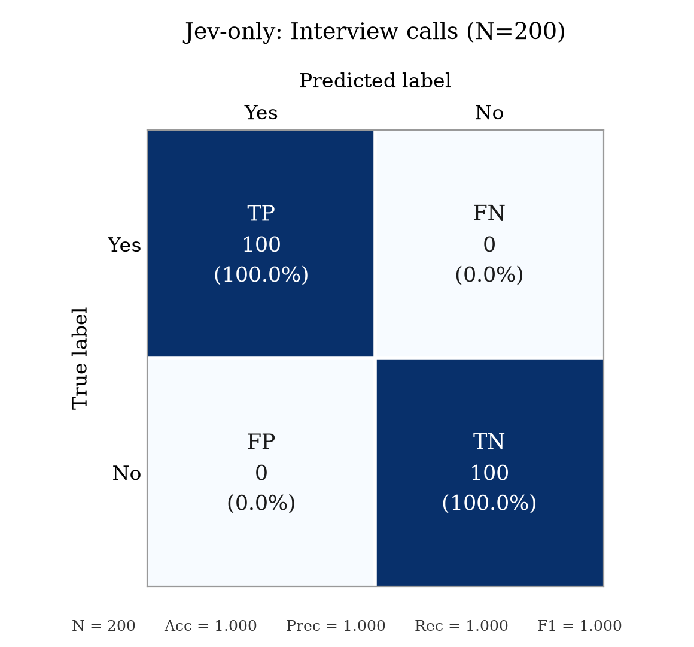

# Plan 1 결과 — Jev 단독 단일 종합 판단

- 실행 시각: 2026-11-07T19:05:44
- 데이터: `experiments/data/interview_200_plan1.csv` (평가 200건, 호출 실패 0건 제외)

## Confusion Matrix (양성 = Yes)

|            | 예측 Yes | 예측 No |
|------------|---------|--------|
| **실제 Yes** | 100 (TP) | 0 (FN) |
| **실제 No**  | 0 (FP) | 100 (TN) |

## 지표

- 평가 샘플 수(실패 제외): **200**
- Accuracy: **1.0000**
- Precision: **1.0000**
- Recall: **1.0000**
- F1: 1.0000

## Latency / 토큰 / 비용

- 측정 호출 수: **200**
- Latency(초): 평균 **0.244**, 중앙값 0.215, p95 0.365, 범위 0.184~0.529
- 입력 토큰: 평균 **2308.1**, 합계 461617
- 출력 토큰: 평균 **34.0**, 합계 6800
- 총 토큰: 평균 **2342.1**, 합계 468417
- 비용: 토큰 단가(`--price-in`/`--price-out`, $/1M tokens) 미지정 — 토큰 수만 기록

## 평가 조건과 해석

- 합성 면접 통화: 사기 100건·정상 100건, 총 200건·14,902문장. 각 통화 50~100문장.
- 직무·경력·문장 수를 통화별로 맞춘 정상/사기 변형이며 20개 주제·100개 직무를 사용했다.
- 정답 역할을 A/B로 바꾸고 중립 ID로 섞었다. 모델에는 역할명·정답·원본 ID를 보내지 않았다.
- 기존 Plan1의 전체 transcript 1회 판단·서비스 공통 프롬프트·API choice verdict를 그대로 사용했다.
- 설정 모델은 `jev-latest`이며 기존 실행기가 실제 응답 모델 버전을 저장하지 않아 정확한 버전은 미확인이다.
- 정상 오경보율 0%, 사기 미탐률 0%, 특이도 100%. CSV 예측 200건을 원본 정답과 다시 대조했다.
- 이 합성 평가셋의 결과이며 실제 통화·ASR 오류 조건의 성능을 뜻하지 않는다. 문답을 공유하므로 독립 표본 200건으로 해석하지 않는다.
- 데이터 생성과 평가 후에 정답이나 대화를 모델 결과에 맞춰 변경하지 않았다. 별도 반복 측정은 하지 않았다.

세부 예측은 [predictions.csv](predictions.csv), 집계는 [summary.json](summary.json), 입력·실행 해시는 [run_manifest.json](run_manifest.json)에 있다.
