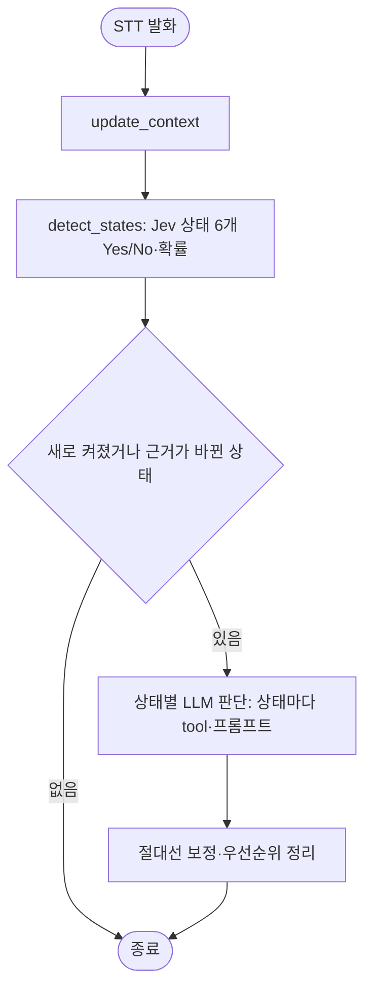

# 변경 설계

상태: 제안

## 기존 구조와 바꿀 부분

- 현재 구조: `update_context → detect_with_jev(voice_phishing Yes/No) → Yes면 respond_with_llm 1회`
- 바꿀 구조
  - Jev 질문을 상태 6개로 늘린다.
  - `respond_with_llm` 하나를 상태별 판단 Node로 나눈다.
- 대화 누적, 오류 처리, 키 비노출 원칙은 그대로 둔다.
- [jev.py](../../../scamshield/jev.py)의 요청 `questions`는 이미 질문 이름을 키로 하는 dict다. 그래서 질문 여러 개는 같은 요청 형식으로 보낼 수 있다. 실제 API가 이를 받는지는 아직 확인하지 않았다.

## State 추가 필드(안)

| 필드 | 의미 |
|---|---|
| `states: dict[str, {verdict, probability}]` | 이번 차례의 Jev 상태별 판단 |
| `handled: dict[str, {evidence, judgment}]` | 상태별로 마지막에 LLM이 판단한 근거와 결과. 다시 부를지 정할 때 쓴다 |
| `call_context: {purpose, claimed_identity}` | LLM이 뽑아 누적하는 통화 목적과 상대가 내세운 신분 |
| `state_analyses: list` | 이번 차례 상태별 LLM 출력을 우선순위대로 정리한 것 |

## 상태별 LLM의 역할과 tool

| 상태 | 맥락 판단의 핵심 | tool(이번에는 모의) |
|---|---|---|
| F1 | 아래 "F1 간단 구성" | 사기계좌 조회 |
| F2 | 요구한 정보가 통화 목적에 필요한지. 예: 대출 상담의 기존 대출 질문은 정상, 수사 협조 중 잔액 질문은 아님 | 없음 |
| F3 | 이동하라는 곳(앱, 링크, 번호, 장소)이 공식 채널인지 | URL·앱·번호 확인 |
| F4 | 상대 주장(사건 연루 또는 혜택)이 실제 절차와 맞는지. 선입금 조건이 붙었는지 | 기관 대표번호 목록, 금융회사 등록 조회 |
| F5 | 고립시키는 방식과 정도 | 보호자 알림(앱 기능) |
| F6 | 상대가 내세운 신분을 뽑아 `call_context`에 저장. 전화로 하는 조사가 실제 절차인지 | 기관 대표번호 목록 |

### F1 간단 구성

친구 간 송금과 사칭 송금 요구를 맥락으로 구분해야 하지만, 단계를 늘리지 않는다(2026-11-16 사용자 결정).

- LLM 호출 1번. 계좌번호가 나오면 LLM이 사기계좌 조회 tool을 부른다.
- 프롬프트에는 "사기인가"를 묻지 않고, 판단 전에 확인할 질문 3개를 준다.
  1. 상대는 누구라고 했나? 그 신분은 이 통화 안에서 스스로 밝힌 것인가?
  2. 무슨 명목과 방법으로 보내라고 하나? (수수료·예치금·안전계좌·현금 전달·상품권 등)
  3. 그 명목이 상대가 밝힌 신분과 맞나? (예: 기관이 개인 계좌로 돈을 받음)
- `response`는 단정 대신 확인 행동을 안내한다. 예: 은행 대표번호로 직접 확인, 친구가 원래 쓰는 번호로 다시 걸기
- 절대선 보정은 코드가 한다(spec의 F1 절대선).
- 대안: 사실 추출(LLM) → 기준 대조(코드) → tool → 애매한 경우만 LLM 판단의 4단계. 결과가 더 일정하지만 복잡하다. 평가에서 친구 송금과 사기를 잘 가르지 못할 때 검토한다.

모든 상태의 LLM은 같은 출력 스키마를 쓴다. 상태별 프롬프트에는 해당 상태의 정의, 절대선, KorCCVi에서 확인된 대표 수법(바꿔 쓴 문장)을 넣는다.

## 선택, 대안, trade-off

- **상태 감지를 Jev로 하는 이유**: 싸고 빠르다. 기준값을 낮게 잡아 놓치지 않는 쪽으로 쓰고, 오탐은 LLM 단계에서 거른다.
  - 대안 1: 매 발화마다 LLM이 상태를 뽑게 한다. 정확하지만 비용과 지연이 크다.
- **상태별 Yes/No 6개로 묻는 이유**: 한 통화에서 상태가 동시에 켜진다(KorCCVi 통화의 88%가 특징 2개 이상).
  - 대안 2: 7지선다(없음 + 6개) 질문 하나로 묻는다. 동시에 켜진 상태를 놓친다.
- **대응을 LLM이 맥락으로 쓰는 이유**: 같은 요구라도 통화 목적에 따라 정상일 수 있다.
  - 대안 3: 전역 고정 문구를 쓴다. 맥락이 맞지 않아 오탐을 키운다.
- **위험**: LLM이 사기범의 정당화에 설득될 수 있다. KorCCVi에서 절차 연출은 83%, 의심 무마는 18%였다.
  - 대응책: 절대선과 판단 근거 제한(spec)을 둔다. 절대선은 코드에서 보정하므로 프롬프트 지시에만 기대지 않는다.

## 결정 사항 (2026-11-16 사용자 결정)

- **기존 `voice_phishing` 질문: 당분간 7번째 질문으로 남긴다. 나중에 없앤다.**
  - 같은 요청에 넣으므로 호출 수가 늘지 않는다. F1~F6에 걸리지 않는 사기를 잡는 안전망이고, 기존 평가(재현율 77%)와 비교하는 기준이 된다.
  - 이 질문만 Yes이고 F1~F6이 모두 No이면 에이전트를 부르지 않고 기록만 남긴다(임시 기본값).
  - 없애는 시점: 평가에서 "이 질문만 Yes인 사기"가 거의 없다고 확인되면 없앤다. 그래서 평가 하네스는 이 경우를 따로 센다.
- **LLM: 상태별 에이전트만 Claude API로 만든다.** 기존 Gemini 대응 경로는 바꾸지 않는다.
- **BE 응답 계약은 바꾸지 않는다.** 상태 결과를 기존 형식으로 바꿔 내보낸다.
  - `action`: 절대선 보정 후 `risky` 판단이 하나라도 있으면 `WARN`, 아니면 `OBSERVE`
  - `score`: 판단 결과별 점수의 통화 누적 합(최대 100)
  - 상태 목록을 그대로 내보내는 계약 변경은 BE 팀과 합의한 뒤 별도로 한다.
- **점수: 임시 값으로 시작하고 KorCCVi 평가 뒤 조정한다.**

  | 판단 | F1·F2·F3 | F5 | F4·F6 |
  |---|---:|---:|---:|
  | `risky` | 40 | 25 | 10 |
  | `uncertain` | 20 | 10 | 5 |
  | `within_normal` | 0 | 0 | 0 |

- **tool: F1·F3용 Mock만 만든다.** F2 기준표는 뒤로 미룬다.
  - F1: 사기계좌 조회
  - F3: URL 확인, 앱 확인(원격제어 앱 여부), 번호 확인(기관 대표번호와 일치 여부)
  - 모든 tool은 `flagged`(위험으로 조회됨), `not_found`(조회 대상 없음), `error`(조회 실패)를 구분해 반환한다. `not_found`는 안전하다는 뜻으로 쓰지 않는다.
  - 대화 원문은 tool 입력으로 보내지 않는다. 계좌번호, URL, 앱 이름, 전화번호만 보낸다.

## 미정 사항

- **상태별 Jev Yes 기준값**: KorCCVi 평가로 정한다.
- **실제 tool API와 출처**: Mock 다음 단계에서 정한다.
- **F2 기관 요구 기준표**: 공식 원문을 확인해 출처와 함께 만든다.

## 관련 상위 설계와 기준 문서

[proposal](proposal.md), [spec](spec.md), [현재 계약](../../../docs/design/state-and-graph.md), [KorCCVi 분석](../../../docs/analysis/korccvi-scam-tactics.md)
