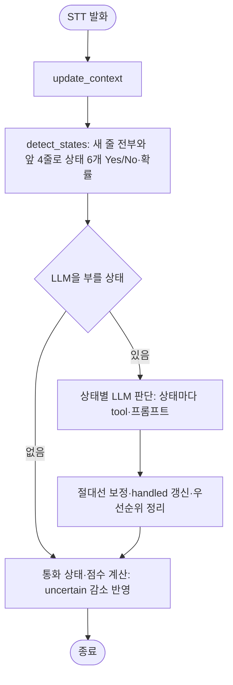

# 변경 설계

상태: 확정(2026-11-22), 구현 중. 구현 기준은 [구현 계약](#구현-계약-2026-11-22)이다.

## 기존 구조와 바꿀 부분

- 현재 구조: `update_context → detect_with_jev(voice_phishing Yes/No) → Yes면 respond_with_llm 1회`
- 바꿀 구조
  - Jev 질문을 상태 6개로 늘린다.
  - `respond_with_llm` 하나를 상태별 판단 Node로 나눈다.
- 대화 누적, 오류 처리, 키 비노출 원칙은 그대로 둔다. Jev에는 누적 대화 대신 최근 5줄만 보낸다(2026-11-22).
- [jev.py](../../../scamshield/jev.py)의 요청 `questions`는 질문 이름을 키로 하는 dict다. 질문 6개를 한 요청으로 보내면 Jev가 대화를 한 번 읽고 질문마다 따로 판단한다(2026-11-16 실호출·2026-11-22 문서 확인).

## State 추가 필드(안)

| 필드 | 의미 |
|---|---|
| `states: dict[str, {verdict, probability}]` | 이번 차례의 Jev 상태별 판단 |
| `handled: dict[str, {evidence, judgment, reason, judged_at}]` | 상태별로 마지막에 LLM이 판단한 근거(그 상태가 Yes가 된 대사), 결과, 이유, 판단한 발화 시각. 다시 부를지 정하고 점수를 계산할 때 쓴다. 점수는 따로 저장하지 않고 `handled`와 지금 발화 시각으로 계산한다 |
| `call_context: {purpose, claimed_identity}` | LLM이 뽑아 누적하는 통화 목적과 상대가 내세운 신분 |
| `state_analyses: list` | 이번 차례 상태별 LLM 출력을 우선순위대로 정리한 것 |

## 상태별 LLM의 역할과 tool

| 상태 | 맥락 판단의 핵심 | tool(이번에는 모의) |
|---|---|---|
| F1 | 아래 "F1 간단 구성" | 사기계좌 조회 |
| F2 | 요구한 정보가 통화 목적에 필요한지. 예: 대출 상담의 기존 대출 질문은 정상, 수사 협조 중 잔액 질문은 아님 | 없음 |
| F3 | 이동하라는 곳(앱, 링크, 번호, 장소)이 공식 채널인지 | URL·앱·번호 확인 |
| F4 | 상대 주장(사건 연루 또는 혜택)이 실제 절차와 맞는지. 선입금 조건이 붙었는지 | 기관 대표번호 목록, 금융회사 등록 조회 |
| F5 | 고립시키는 방식과 정도 | 보호자 알림(앱 기능) |
| F6 | 상대가 내세운 신분을 뽑아 `call_context`에 저장. 전화로 하는 조사가 실제 절차인지 | 기관 대표번호 목록 |

tool 열은 상태별 후보다. 이번에 만드는 Mock은 F1·F3 tool뿐이다(2026-11-19 결정). F4·F5·F6 tool은 이후 단계다.

### F1 간단 구성

친구 간 송금과 사칭 송금 요구를 맥락으로 구분해야 하지만, 단계를 늘리지 않는다(2026-11-16 사용자 결정).

- LLM 호출 1번. 계좌번호가 나오면 LLM이 사기계좌 조회 tool을 부른다.
- 프롬프트에는 "사기인가"를 묻지 않고, 판단 전에 확인할 질문 3개를 준다.
  1. 상대는 누구라고 했나? 그 신분은 이 통화 안에서 스스로 밝힌 것인가?
  2. 무슨 명목과 방법으로 보내라고 하나? (수수료·예치금·안전계좌·현금 전달·상품권 등)
  3. 그 명목이 상대가 밝힌 신분과 맞나? (예: 기관이 개인 계좌로 돈을 받음)
- `response`는 단정 대신 확인 행동을 안내한다. 예: 은행 대표번호로 직접 확인, 친구가 원래 쓰는 번호로 다시 걸기
- 절대선 보정은 코드가 한다(spec의 F1 절대선).
- 대안: 사실 추출(LLM) → 기준 대조(코드) → tool → 애매한 경우만 LLM 판단의 4단계. 결과가 더 일정하지만 복잡하다. 평가에서 친구 송금과 사기를 잘 가르지 못할 때 검토한다.

모든 상태의 LLM은 같은 출력 스키마를 쓴다. 상태별 프롬프트에는 해당 상태의 정의, 절대선, KorCCVi에서 확인된 대표 수법(바꿔 쓴 문장)을 넣는다.

## 선택, 대안, trade-off

- **상태 감지를 Jev로 하는 이유**: 싸고 빠르다. 기준값을 낮게 잡아 놓치지 않는 쪽으로 쓰고, 오탐은 LLM 단계에서 거른다.
  - 대안 1: 매 발화마다 LLM이 상태를 뽑게 한다. 정확하지만 비용과 지연이 크다.
- **상태별 Yes/No 6개로 묻는 이유**: 한 통화에서 상태가 동시에 켜진다(KorCCVi 통화의 88%가 특징 2개 이상).
  - 대안 2: 7지선다(없음 + 6개) 질문 하나로 묻는다. 동시에 켜진 상태를 놓친다.
- **대응을 LLM이 맥락으로 쓰는 이유**: 같은 요구라도 통화 목적에 따라 정상일 수 있다.
  - 대안 3: 전역 고정 문구를 쓴다. 맥락이 맞지 않아 오탐을 키운다.
- **위험**: LLM이 사기범의 정당화에 설득될 수 있다. KorCCVi에서 절차 연출은 83%, 의심 무마는 18%였다.
  - 대응책: 절대선과 판단 근거 제한(spec)을 둔다. 절대선은 코드에서 보정하므로 프롬프트 지시에만 기대지 않는다.

## 결정 사항 (2026-11-16 사용자 결정)

- **기존 `voice_phishing` 질문: 당분간 7번째 질문으로 남긴다. 나중에 없앤다.**
  - 같은 요청에 넣으므로 호출 수가 늘지 않는다. F1~F6에 걸리지 않는 사기를 잡는 안전망이고, 기존 평가(재현율 77%)와 비교하는 기준이 된다.
  - 이 질문만 Yes이고 F1~F6이 모두 No이면 에이전트를 부르지 않고 기록만 남긴다(임시 기본값).
  - 없애는 시점: 평가에서 "이 질문만 Yes인 사기"가 거의 없다고 확인되면 없앤다. 그래서 평가 하네스는 이 경우를 따로 센다.
  - 2026-11-22에 바꿨다: 구현에서 뺀다. 창·묶음 방식 측정을 모두 이 질문 없이 했다.
- **LLM: 상태별 에이전트만 Claude API로 만든다.** 기존 Gemini 대응 경로는 바꾸지 않는다.
  - 2026-11-22에 바꿨다: Gemini 경로를 뺀다. 새 그래프에서 부르는 곳이 없다.

## 결정 사항 (2026-11-19 사용자 결정)

- **역할 분리: Jev는 행동이 나왔는지만, LLM은 그 행동이 맥락상 수상한지를 판단한다.**
  - Jev 상태 Yes는 경고가 아니라 LLM을 부를 후보다. `risky`/`within_normal`/`uncertain`은 LLM이 낸다.
  - 정상 상담의 F3(번호·사이트·장소 안내)·F6(기관 소개) Yes는 Jev 질문을 좁혀 없애지 않고 LLM이 거른다. 질문을 좁히면 Jev 재현이 떨어진다.
- **상태별 LLM은 Claude Haiku로 시작한다.** 입력은 spec대로 누적된 전체 대화다. 판단 근거(상대 신분, 통화 목적)가 통화 앞부분에 있기 때문이다.
- **F3·F5만 켜진 동안은 LLM을 부르지 않는다**(spec 라우팅 예외). KorCCVi에서 F3·F5 단독 사기는 각각 1%다. 근거: [단독 출현](../../../docs/analysis/korccvi-scam-tactics.md#행동-특징-f1f6으로-다시-묶기)
  - 남은 위험: 원격제어 앱 설치(F3 절대선)가 다른 상태 없이 나오면 경고가 늦어진다. Haiku 검증 실험과 대사 단위 평가에서 빈도를 본다.
- **BE 응답 계약은 바꾸지 않는다.** 상태 결과를 기존 형식으로 바꿔 내보낸다.
  - `action`: 절대선 보정 후 `risky` 판단이 하나라도 있으면 `WARN`, 아니면 `OBSERVE`
  - `score`: 판단 결과별 점수의 통화 누적 합(최대 100). 2026-11-22 결정으로 상태별 칸의 합으로 바뀌었다(아래).
  - 상태 목록을 그대로 내보내는 계약 변경은 BE 팀과 합의한 뒤 별도로 한다.
- **점수: 임시 값으로 시작하고 KorCCVi 평가 뒤 조정한다.**

  | 판단 | F1·F2·F3 | F5 | F4·F6 |
  |---|---:|---:|---:|
  | `risky` | 40 | 25 | 10 |
  | `uncertain` | 20 | 10 | 5 |
  | `within_normal` | 0 | 0 | 0 |

- **tool: F1·F3용 Mock만 만든다.** F2 기준표는 뒤로 미룬다.
  - F1: 사기계좌 조회
  - F3: URL 확인, 앱 확인(원격제어 앱 여부), 번호 확인(기관 대표번호와 일치 여부)
  - 모든 tool은 `flagged`(위험으로 조회됨), `not_found`(조회 대상 없음), `error`(조회 실패)를 구분해 반환한다. `not_found`는 안전하다는 뜻으로 쓰지 않는다.
  - 대화 원문은 tool 입력으로 보내지 않는다. 계좌번호, URL, 앱 이름, 전화번호만 보낸다.

## 결정 사항 (2026-11-22 사용자 결정)

- **Jev에는 최근 5줄만 보내고 마지막 대사를 판단하게 한다**(v5 후보 채택).
  - 이유: 이미 켜진 상태는 State가 기억하므로 Jev는 지금 대사만 보면 된다. 누적 대화를 보내면 한 번 켜진 상태가 끝까지 Yes라 같은 상태가 다시 나왔는지 알 수 없다. 대화 길이에 따른 비용·지연 차이는 작다.
  - 측정(사기 40·정상 20통화): 통화 단위 재현은 전체 1회 판단과 같거나 높고(F3만 1통화 적음), 정상 통화의 F3·F6 Yes 대사는 누적 방식의 약 1/4이다. 근거: [창 방식 비교](../../../docs/analysis/jev-state-question-versions.md#v5-후보--최근-5줄-창-2026-11-22)
  - 상태별 LLM의 입력은 그대로 전체 대화다. 앞 4줄 안에 없는 맥락(상대 신분, 통화 목적)은 LLM이 본다.
  - 남은 위험: 5줄보다 멀리 떨어진 앞 대사와 이어져야 완성되는 행동은 놓칠 수 있다.
- **BE가 새 발화를 여러 줄 합쳐 보내면 새 줄 전부를 한 번에 묻는다.** 새 줄 전부와 그 앞 4줄을 보내고 "새 대사 중에 행동이 있나"로 묻는다. 처음에는 새 줄마다 창을 만들기로 했으나, 같은 날 측정 뒤 바꿨다.
  - 이유: BE는 실행 대기 중인 작업에 새 발화를 합치고, `agent-bridge`는 마지막 줄만 새 대사로 넘긴다. 마지막 대사만 물으면 가운데 줄의 행동을 놓친다. 예전 누적 방식에는 없던 문제다.
  - 측정(12통화, 3줄씩 묶음 67요청): 줄마다 묻는 방식과 상태별 판단이 95% 같았다. 사기 정답 묶음 재현은 18/33으로 같고, 정상 통화 Yes 묶음은 4로 줄마다(7)보다 적었다. 맥락 줄의 행동을 새 대사로 착각하는 경향은 보이지 않았다. 근거: [묶음 확인](../../../docs/analysis/jev-state-question-versions.md#v5-새-줄-묶음-확인-2026-11-22)
  - 이점: Jev 호출이 요청마다 1번이고, 줄마다 창을 만들어 합치는 코드가 없다.
  - 남은 위험: 표본이 작다. 큰 표본 평가에서 다시 본다.
- **같은 상태의 LLM 재호출: 이전 판단이 `risky`면 다시 부르지 않고, `uncertain`·`within_normal`이면 그 상태가 다시 Yes일 때 다시 부른다.**
  - 이유: 창 방식에서 Yes가 난 대사마다 부르면 통화당 사기 15.6회, 정상 1.4회다. `risky`는 고정이라 다시 판단할 필요가 없다. `within_normal`도 다시 부르는 것은 앞의 정상 결제 안내 뒤에 사칭 송금 요구가 나올 수 있기 때문이다.
- **SUSPECT·WARN 두 단계를 통화 상태(위험·주의·정상)로 바꾼다.**
  - 예전에는 Jev 확률로 점수를 만들고 점수로 단계를 정했다(40 이상 SUSPECT, 70 이상 WARN). 새 구조는 상태별 판단으로 통화 상태를 정하고, 점수는 판단에서 계산한다.
  - 알림은 위험일 때만 띄운다. 정상 상담 50/80통화에서 첫 기관 소개만으로 F6이 켜졌으므로, 주의마다 알리면 정상 통화에서 알림이 잦다.
  - 점수와 통화 상태는 어긋날 수 있다. 예: F6 하나만 `risky`면 10점이지만 위험이다. 통화 상태는 확인된 위험이 있는지를, 점수는 경계할 정도를 보여 준다.
- **점수 = 이 통화에서 지금 사용자가 경계해야 하는 정도.** 확인된 위험(`risky`)과 아직 확인되지 않은 의심(`uncertain`)의 합이다. 계산 규칙은 [spec](spec.md#충족해야-할-동작)에 있다.
  - `risky` 고정 이유: 사기범은 요구 뒤 안심시키거나, 이동하는 동안 통화를 붙잡아 두며 조용한 구간을 만든다. 확인된 위험을 내리면 피해자가 돈을 옮기는 시점에 점수가 낮아진다.
  - `uncertain`을 시간으로 줄이는 이유: 의심만 남은 채 평범한 대화가 이어지면 정상일 가능성이 커진다. `risky`는 고정이고 알림은 점수가 아니라 `risky`로 띄우므로, 줄여도 놓치는 알림은 없다. 멘토링 지적(점수가 내려가지 않음)에 대한 답이다. 근거: [work](work.md#멘토링-지적-기존-점수-2026-11-22)
  - 대사 수가 아니라 시간으로 재는 이유: BE 발화 한 줄은 리턴제로 STT가 쉬는 지점에서 확정한 구간이라 KorCCVi 한 줄과 길이가 다르고, 한 요청에 합쳐지는 줄 수도 매번 다르다.
  - 대안: `uncertain` 뒤 일정 시간이 지나면 Haiku를 다시 부른다. 결론을 낼 수 있지만 호출이 늘어서 택하지 않았다.
  - 1분과 절반은 처음 값이다. Haiku 실험에서 정상 통화의 주의 상태가 얼마나 남는지 보고 조정한다.
- **BE 항목**: 처음엔 팀원과 협의할 항목으로 두었으나, 구현 전 결정으로 Java·DB를 바꾸지 않고 `agent-bridge`만 바꾸기로 했다. 아래 [구현 계약](#구현-계약-2026-11-22)의 BE 절을 따른다.

## 결정 사항 (2026-11-22 구현 전 사용자 결정)

구현 전에 정할 항목을 권장안대로 정했다. BE는 되도록 고치지 않는다. 개인 프로젝트라 데모데이에 잘 동작하는 수준을 목표로 한다.

- **입출력**: agent 입구는 `CallPipeline.analyze` 하나다. 브리지는 그래프 내부를 건드리지 않는다.
- **통화 상태 저장**: BE `newState`에 상대별 agent 상태를 넣는다. BE가 이미 `agent_state`를 저장하고 다음 요청에 돌려준다.
- **시간**: 발화 시각이 오면 그 시각을, 없으면 브리지가 요청을 받은 시각을 쓴다.
- **Gemini 경로와 `voice_phishing` 질문을 뺀다.**
- **`uncertain` 기준**: Haiku 실험 기준을 채택한다. 돈·정보가 상대 쪽으로 넘어가는 요구가 통화 목적에 비해 과하거나 맞지 않거나 사칭·겁주기·비밀 유지와 함께 나오면 `risky`, 통화 목적이 분명하고 그 행동이 목적에 꼭 필요하면 `within_normal`, 둘 다 판단할 근거가 아직 없을 때만 `uncertain`이다.
- **절대선**: Haiku의 `absolute_line`과 F3 앱 확인 tool의 원격제어 판정 중 하나라도 걸리면 `risky`다. `absolute_line`은 절대선이 있는 F1·F2·F3·F5에서만 본다. 핵심 표현 키워드 검사는 이번에 넣지 않는다.
- **tool 결과**: `flagged`면 코드가 `risky`로 고정한다. `error`는 판단에 쓰지 않고 Haiku에 조회 실패로 알리며 기록한다. F1·F3 모두 Haiku가 tool calling으로 부른다.
- **Haiku 실패·잘못된 출력**: 그 상태만 판단하지 않은 것으로 두고, 다음 Yes에서 다시 부른다. 요청 전체를 오류로 만들지 않는다. Jev 실패는 지금처럼 오류다.
- **`call_context`**: 모든 Haiku 출력에 목적·신분 갱신값을 넣어 합친다.
- **BE 필드**: `message`는 `risky` 상태 중 우선순위가 가장 높은 상태의 `response`, `reason`은 켜진 상태의 이유를 우선순위 순서로, `evidenceSeqs`는 `risky` 상태의 근거 대사 번호다.
- **동시 호출**: 여러 상태가 켜지면 Haiku를 동시에 부르고 결과는 우선순위로 정리한다.
- **프롬프트**: 실험처럼 공통 프롬프트 하나에 상태별 정의·절대선·초점을 넣는다.
- **Haiku 검증의 남은 검토**
  - 짧은 수사기관 사칭: `uncertain`으로 둔다. 요구가 나오면 그때 `risky`가 된다.
  - 신분 주장 근거 사용: 프롬프트에 "상대가 말한 기관·지점이 공식인지는 대화로 확인할 수 없다"를 넣는다.
  - 정상 통화 주의 시간(평균 23%): 주의는 알림이 아니므로 그대로 두고, BE 주의 표시를 정한 뒤 조정한다.
- **범위**: `actions`는 출력 스키마에 넣되 BE에는 보내지 않는다. Mock tool 데이터는 고정 목록이다. F1 송금 직전 준비 행동은 미룬다.

## 구현 계약 (2026-11-22)

### agent (`scamshield`)

- 입구: `CallPipeline.analyze(history, new_lines, state, now) -> AnalysisOutcome`
  - `history: list[str]`: 이번 요청 전까지의 대화. 한 줄은 `"[화자] 발화"`다.
  - `new_lines: list[NewLine]`: 이번 요청의 새 줄. `NewLine = {seq: int, text: str}`이고 `text`는 같은 `"[화자] 발화"` 형식이다. 1줄 이상이다.
  - `state: dict | None`: 이전 출력의 `state`. `None`이면 새 통화다.
  - `now: float`: 이번 새 줄의 시각(초). 점수 감소를 잰다.
  - 상태를 입력으로만 받으므로 같은 요청을 재시도해도 판단이 두 번 쌓이지 않는다. checkpointer에 기대지 않는다.
- 출력 `AnalysisOutcome`
  - `status`: `"위험" | "주의" | "정상"`, `score`: 0~100 정수([spec](spec.md#충족해야-할-동작)의 점수 규칙)
  - `message`, `reason`, `evidence_seqs`: 위 BE 필드 결정대로. `message`는 위험이 아니면 `None`이다. `reason`은 `risky`와 점수가 남은 `uncertain` 상태의 이유를 `"F1: …"` 꼴로 이어 붙이고, 없으면 `None`이다.
  - `states`: 이번 Jev 판단(상태별 `verdict`·`probability`), `state_analyses`: 이번에 부른 Haiku 결과(우선순위 순)
  - `state`: 다음 요청에 넘길 JSON 직렬화 가능한 dict
    - `handled`: 상태별 `{judgment, reason, response, actions, evidence_seqs, judged_at}`
    - `call_context`: `{purpose, claimed_identity}`
    - `seen`: 이 통화에서 한 번이라도 Yes가 된 상태, `held`: F3·F5 보류 중인 상태와 근거 대사 번호
- Jev: 요청마다 1번. `history`의 마지막 4줄과 새 줄 전부를 보내고, [묶음 확인](../../../docs/analysis/jev-state-question-versions.md#v5-새-줄-묶음-확인-2026-11-22)에 쓴 질문(`experiments/jev_states/chunk_states.py`)으로 상태 6개를 묻는다. 대기 10초. 실패하면 지금처럼 `PipelineError`다.
- Haiku: `claude-haiku-5-5`, effort `low`, 키는 `ANTHROPIC_API_KEY`
  - 프롬프트는 Haiku 실험(`experiments/jev_states/haiku_states.py`)의 공통 프롬프트에 신분 주장 문장을 더한 것이다. 입력은 전체 대화(`history`+새 줄), 상태 이름과 Jev 확률, `call_context`, 다시 부를 때 이전 판단이다.
  - 출력 JSON: `{judgment, absolute_line, reason, response, actions, call_context}`
  - tool: F1 `check_account`, F3 `check_url`·`check_app`·`check_phone`. tool 왕복은 2번까지다.
  - API 호출마다 대기 15초, 자동 재시도 없음. 상태별로 동시에 부른다.
  - 실패하면 그 상태만 건너뛰고 오류 코드만 기록한다. 대화 내용은 로그에 쓰지 않는다.
- 뺄 것: `gemini.py`, `langchain-google-genai` 의존성, `voice_phishing` 질문. 더할 것: `anthropic` 의존성(`uv.lock` 갱신)
- 키 없는 대역: `OfflineDetector`·`OfflineAnalyst`를 새 구조에 맞춘다. 브리지 `--offline`, 그래프 그림 출력, 테스트가 쓴다.
- 테스트: API를 부르지 않는다. Jev·Haiku 대역으로 라우팅(F3·F5 보류, 재호출), 절대선·tool 보정, 점수 감소, Haiku 실패, BE 필드를 확인한다.

### BE (`agent-bridge`만)

- Java·DB는 바꾸지 않는다.
  - 위험이 아니면 점수를 39 이하로 보낸다. `ResultApplier`는 점수 40 이상을 SUSPECT로 알리므로, 이렇게 하면 `levelOf`를 고치지 않아도 위험일 때만 알림이 뜬다. 지금 브리지의 오탐 처리와 같은 방식이다.
  - 발화 시각은 브리지가 요청을 받은 시각으로 대신한다.
  - 알림은 단계가 오를 때만 뜨고 내려가지 않으므로 "이미 띄운 알림은 취소하지 않기"는 이미 지켜진다.
- `newState = {transcript, peers}`
  - `transcript`: 지금처럼 `"[상대:<trackId>]"` 표시를 붙인 전체 대화
  - `peers`: 상대 `trackId`별 agent `state`. 상대가 아직 없을 때는 키 `""`를 쓴다. `peers`가 없는 예전 상태는 빈 상태로 본다.
- 판단: 지금처럼 이번에 말한 상대의 쌍만, `[나]`·사용자 입력이 있으면 모든 쌍을 판단한다. 쌍마다 `history`는 이전 `transcript`의 쌍 대화, `new_lines`는 이번 요청에서 그 쌍에 속한 줄과 `seq`다. 판단하지 않은 쌍의 상태는 그대로 둔다.
- 응답 변환
  - `action`: 위험이면 `WARN`, 아니면 `OBSERVE`
  - `score`: 위험이면 그대로, 아니면 `min(score, 39)`
  - `message`·`reason`·`evidenceSeqs`: agent 출력. 상대가 있으면 `reason` 앞에 `"[<trackId>]"`를 붙인다.
  - 가장 위험한 쌍(WARN 먼저, 다음 점수)을 따른다.
- 대기 시간: 쌍 하나에 Jev 10초 + Haiku 최대 2×15초 = 40초로, BE `agent.timeout-ms`(55초) 안이다. 쌍은 차례로 판단하므로 상대가 둘 이상 동시에 말하면 넘을 수 있다. 데모는 상대 1명으로 한다.
- 설정: 운영 compose의 Gemini 환경 변수를 `ANTHROPIC_API_KEY`로 바꾼다. 배포 전에 서버 `.env`에 키가 있어야 한다.
- 순서: BE CI와 운영은 scam-agent `main`을 받는다. scam-agent PR을 `main`에 먼저 합치고 BE PR을 `dev`에 합친다. BE `dev`에 합치면 운영에 자동 배포된다.

## 미정 사항

- **주의를 BE에 전하는 방법과 화면 표시**: 지금은 점수로만 보인다.
- **`actions`를 받을 BE 필드**
- **F1 송금 직전 준비 행동**(예금 해지·대출 실행·자금 보관): Jev 질문이 바뀌므로 따로 잰다.
- **상태별 Jev Yes 기준값**: KorCCVi 평가로 정한다.
- **실제 tool API와 출처**: Mock 다음 단계에서 정한다.
- **F2 기관 요구 기준표**: 공식 원문을 확인해 출처와 함께 만든다.

## 관련 상위 설계와 기준 문서

[proposal](proposal.md), [spec](spec.md), [현재 계약](../../../docs/design/state-and-graph.md), [KorCCVi 분석](../../../docs/analysis/korccvi-scam-tactics.md)
